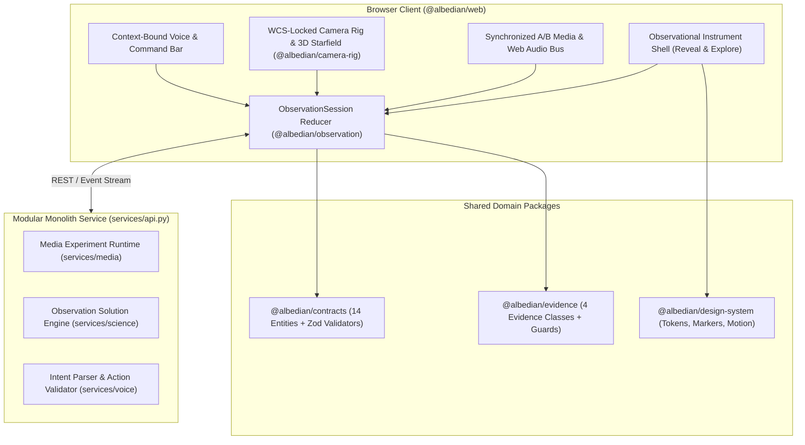

# Albedian Architecture Overview

## 1. System Topology

## 2. The 14 Core Domain Entities

Defined authoritatively in [`packages/contracts/src/index.ts`](../../packages/contracts/src/index.ts):

1. `ObservationSession` — Root aggregate coordinating the 4+1 orthogonal state machines, active selection, observer context, and history.
2. `SourceAsset` — Immutable content-addressed original photograph or video (`sha256`, dimensions, codec, FPS, audio stream metadata).
3. `MediaVariant` — Derivative media asset produced by a `ProcessingAttempt`, aligned to the canonical `SourceAsset` timeline.
4. `ProcessingGraph` — Acyclic, typed DAG of deterministic and prior-assisted media operations (`tone_curve`, `spatial_denoise`, `temporal_stack`, `star_protect_merge`, `region_mask`).
5. `ProcessingAttempt`: versioned execution instance of a `ProcessingGraph`, with the wall time of the run (reported as `cpuMs`) and quality evaluation metrics. `gpuMs` and `peakMemoryBytes` are not measured: today they are a constant 0 and twice the output frame bytes [open].
6. `ObservationSolution` — Versioned astrometric calibration record (`calibrated`, `predicted_only`, `unresolved`, `ambiguous`) with WCS parameters and held-out pixel residuals.
7. `CelestialFinding` — A detected, catalog-matched, predicted, or simulated astronomical object with stable ID and `EvidenceClass`.
   An `observed` finding has a sky position only when its solution's WCS passed held-out verification; without one it is located by its pixel `sourceDetection` alone. A `catalog_matched` finding needs that verified WCS too.
8. `CatalogReference` — Pinned external catalog record (`Gaia DR3`, `Hipparcos`, `JPL Horizons`) with epoch, astrometric parameters, and proper motion.
9. `ScientificEvidence` — Audit trail linking pixel measurements, WCS residuals, Bailer-Jones distance intervals, and explicit limitations.
10. `SpatialViewState` — Current observer origin (parsecs), simulation epoch, camera pose, scale policy, and active overlays.
11. `CameraCheckpoint` — Immutable snapshot of media time, playback state, audio gain, crop, selected finding, and camera rig for exact restoration.
12. `VoiceAction` — Schema-validated `AlbedianAction` command bound to `ActionContext` and `expectedViewRevision`.
13. `NavigationHistory` — Reversible stack of `CameraCheckpoint` snapshots supporting full (`checkpoint`) and continuous (`partial`) backtracking.
14. `ExportArtifact` — Verified output media file and machine-readable provenance manifest (`sourceSha256`, `outputSha256`, audio sync verification, WCS & catalog citations).

---

## 3. Architecture Decision Summary (ADRs)

- **ADR-0001 — Observation-Centered Modular Monolith:** TypeScript monorepo (`pnpm` workspaces) + unified Python FastAPI scientific/media service (`services/api.py`) sharing strict Zod/Pydantic schemas (`packages/contracts`).
- **ADR-0002 — Four Classes of Scientific Evidence (`EvidenceClass`):** Every finding and marker is typed as `observed`, `catalog_matched`, `predicted`, or `simulated` (`packages/evidence`).
- **ADR-0003 Hybrid 3D Spatial Engine (`@sparkjsdev/spark` + Custom WebGL2 Shaders):** Combines anisotropic 3D Gaussian splats (`@sparkjsdev/spark`) on a Local Bubble mesh of unrecorded origin with analytical-derivative GPU ray-marching, a pre-baked Bruneton atmospheric lookup table, and an approximate Schwarzschild bending of light around a hand-set disk (`apps/web/src/spatial/SparkPortalRenderer.ts`).
- **ADR-0004 — Context-Bound Voice Direct Manipulation:** Spoken and typed intents resolve deictic pronouns (`"that one"`, `"take me there"`, `"go back"`) against `ActionContext` and `expectedViewRevision`.

---

## 4. Engineering Standards, Verification & Catalog Attributions

- **Verification Gates:** All changes require passing `pnpm typecheck`, `pnpm test` (Vitest + `fast-check` property-based tests), and `uv run pytest` (Python + `hypothesis` property-based tests).
- **Third-Party Astronomical Data & Licenses:**
  - **ESA Gaia DR3 (`I/355/gaiadr3`) & Bailer-Jones et al. (`I/352`):** Credit: ESA/Gaia/DPAC (CC BY-NC 3.0 IGO, as [docs/science/CATALOG_STAR_TILES.md](../science/CATALOG_STAR_TILES.md) records).
  - **ESA Hipparcos 2007 (van Leeuwen 2007, through the ESA archive):** Credit: ESA (CC BY-NC 3.0 IGO). SIMBAD is not queried.
  - **NASA LRO LOLA and LROC, through the NASA SVS CGI Moon Kit:** NASA media, not subject to copyright in the United States.
  - **Ephemerides:** the Standish and Williams (1992) approximate Keplerian elements (JPL Solar System Dynamics) for the planets and Meeus (1998) chapter 47 for the Moon. No finding uses JPL Horizons data; only the landing scene's baked Sun and Moon positions come from it, through `scripts/plan_landing_moment.py` (the NASA/JPL Horizons API, ephemeris DE441), recorded in `apps/web/src/spatial/webgpu/cislunar/landingMoment.json`. The terms for Horizons' answers and for DE440 and DE441 are [open].
  - **Precomputed Atmospheric Scattering Formulation:** Adapted from Eric Bruneton (2017/2020, BSD-3-Clause).
