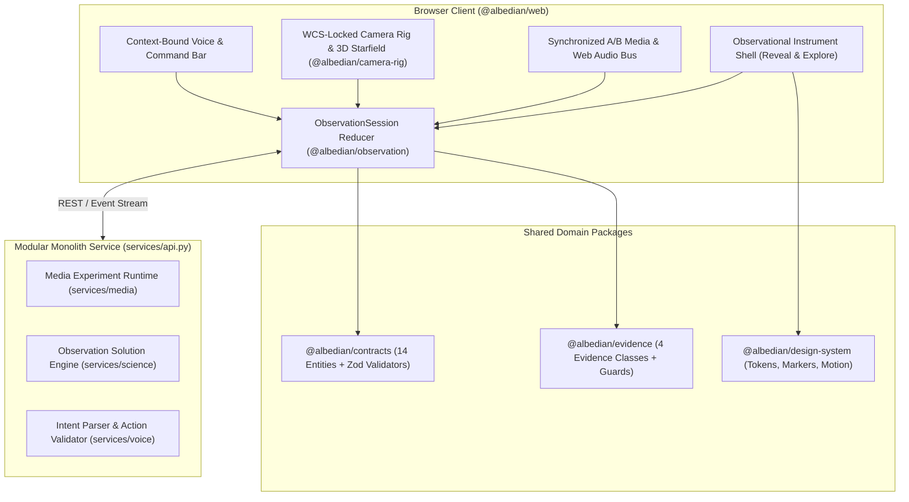

# Albedian Architecture Overview

## 1. System Topology

## 2. The 14 Core Domain Entities

Defined authoritatively in [`packages/contracts/src/index.ts`](../../packages/contracts/src/index.ts):

1. `ObservationSession` — Root aggregate coordinating the 4+1 orthogonal state machines, active selection, observer context, and history.
2. `SourceAsset` — Immutable content-addressed original photograph or video (`sha256`, dimensions, codec, FPS, audio stream metadata).
3. `MediaVariant` — Derivative media asset produced by a `ProcessingAttempt`, aligned to the canonical `SourceAsset` timeline.
4. `ProcessingGraph` — Acyclic, typed DAG of deterministic and prior-assisted media operations (`tone_curve`, `spatial_denoise`, `temporal_stack`, `star_protect_merge`, `region_mask`).
5. `ProcessingAttempt` — Versioned execution instance of a `ProcessingGraph` with real timing, memory, and quality evaluation metrics.
6. `ObservationSolution` — Versioned astrometric calibration record (`calibrated`, `predicted_only`, `unresolved`, `ambiguous`) with WCS parameters and held-out pixel residuals.
7. `CelestialFinding` — A detected, catalog-matched, predicted, or simulated astronomical object with stable ID and `EvidenceClass`.
8. `CatalogReference` — Pinned external catalog record (`Gaia DR3`, `Hipparcos`, `JPL Horizons`) with epoch, astrometric parameters, and proper motion.
9. `ScientificEvidence` — Audit trail linking pixel measurements, WCS residuals, Bailer-Jones distance intervals, and explicit limitations.
10. `SpatialViewState` — Current observer origin (parsecs), simulation epoch, camera pose, scale policy, and active overlays.
11. `CameraCheckpoint` — Immutable snapshot of media time, playback state, audio gain, crop, selected finding, and camera rig for exact restoration.
12. `VoiceAction` — Schema-validated `AlbedianAction` command bound to `ActionContext` and `expectedViewRevision`.
13. `NavigationHistory` — Reversible stack of `CameraCheckpoint` snapshots supporting full (`checkpoint`) and continuous (`partial`) backtracking.
14. `ExportArtifact` — Verified output media file and machine-readable provenance manifest (`sourceSha256`, `outputSha256`, audio sync verification, WCS & catalog citations).
