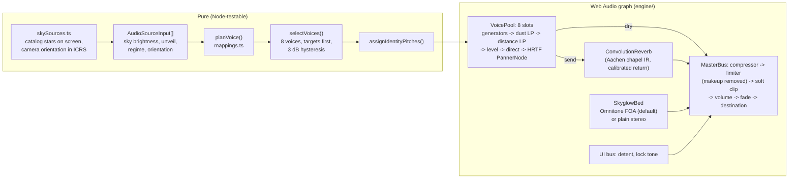

# Albedian Spatial Audio Engine

Status: **Locally implemented and tested capability**. Pure mappings and the musical data layer are
covered by property tests (`[tested]`); the Web Audio graph and the three musical directions over
the landing are exercised and measured in headless Chrome on macOS (`[tested]`). The primary audio
architecture is music first (section 13): a composed, adaptive musical score in which the catalog
stars on screen play the data layer (`apps/web/src/audio/music/`). The continuous Planck-voice sky
feed (`SkyAudioFeed`, section 8) remains implemented and tested, with the application's `skyAudio`
singleton configured with continuous star voices disabled (`voices: false`). Where the music's
samples are served (development with `serveSources.mjs`, or a build given
`VITE_ALBEDIAN_MUSIC_SOURCES`), enabling audio plays the soundtrack live: its director picks a piece
for the moment of the visit, and the feed hands it the stars on screen (section 13.7). Where they
are not (a production build today, or development without the sources server), and with the Music
setting off, no music plays, the feed loads no tile for it, the disclosure says so and the Music
control is not shown; enabling audio then plays only the UI detent.

Code: [`apps/web/src/audio/`](../../apps/web/src/audio/) (including [`apps/web/src/audio/music/`](../../apps/web/src/audio/music/)).
Harnesses: [`apps/web/spike/music/`](../../apps/web/spike/music/) (music directions, section 13) and
[`apps/web/spike/audio/`](../../apps/web/spike/audio/) (`pnpm dev`, open `/spike/music/` or `/spike/audio/`).

## 1. Rules the engine follows

1. **One perceptual channel per physical quantity.** Each quantity drives exactly one audible
   attribute, listed in section 4. Pitch carries no quantity (section 4.8).
2. **A missing input silences what it drives.** Every mapping returns `null` for a missing or
   invalid input and the engine renders `null` as silence. A star without `teffK` is not played
   with a "neutral" timbre; a voice without `residualArcsec` gets no uncertainty layer at all
   (not a clean interval, which would claim a lock); without `extinctionAvMag` there is no
   muffling filter. `getSnapshot().silent` names the missing inputs.
3. **No narration and no theater.** The procedural per-regime drones (the "MHD convection hum",
   the "relativistic sub-bass") were removed because they encoded no data. With no data, enabling
   audio plays only the UI detent.
4. **No AudioContext before a user gesture.** Importing the module and every setter are
   context-free; only `toggle()`/`enable()` (or `SpatialAudioEngine.start()`) create or resume
   one, and those are called from click handlers. A test stubs `window.AudioContext` to check it.

## 2. Architecture



| File | Role |
|---|---|
| `mappings.ts` | Every data-to-parameter mapping (pure). |
| `voicePlanning.ts` | Input types, `planVoice`, `selectVoices`, identity pitches, listener geometry (pure). |
| `skySources.ts` | The catalog stars on screen as `AudioSourceInput`s from core and astro tiles, and the camera's orientation in ICRS (pure). |
| `SkyAudioFeed.ts` | Follows the camera pose each frame while audio is on, with its own tile loader; the `skyAudio` singleton (section 8). |
| `audioCredits.ts` | The credit lines for Omnitone, its SADIE filters and the chapel response, and the URL of `assets/THIRD_PARTY_NOTICES.txt` (section 7). |
| `dsp.ts` | Seeded noise, diffuse-field encodings, soft-clip curve, Schroeder phases, PeriodicWave coefficients, pulse-train series, IR energy normalization (pure). |
| `engine/SpatialAudioEngine.ts` | Composition root and lifecycle; `getSnapshot()` reports what sounds and why. |
| `engine/VoicePool.ts` | Bounded pool of HRTF voices realizing plans. |
| `engine/SkyglowBed.ts` | Bed renderers and the Omnitone loader with fallback. |
| `engine/ConvolutionReverb.ts` | Shared convolution reverb and its calibration. |
| `engine/MasterBus.ts` | Dynamics, clipping, volume, per-ear meter. |
| `ObservatoryAudioEngine.ts` | Public facade keeping the original API; `observatoryAudio` singleton. |
| `omnitone.d.ts` | Types for the parts of Omnitone the bed uses (the package ships none). |

**Lifecycle.** `start()` builds the graph, then loads two things asynchronously: the impulse
response (800 KB WAV, fetched on first enable) and Omnitone (dynamic `import()`, 52 KB minified
ESM). Neither is fetched for users who never enable audio. `stop()` fades the master out and
suspends the context 1.2 s later, so a disabled engine costs no CPU; the next `start()` resumes it.
Data set before `start()` is kept and plays at once when audio is enabled.

## 3. Spatial bed: library evaluation and choice

| | Omnitone 2.0.0 | Resonance Audio Web SDK 1.0.0 | Plain Web Audio |
|---|---|---|---|
| Maintenance | Active: 2.0.0 published September 2026, repository pushed October 2026 (CSP, bundler, promise-rejection and rotation fixes). | Repository archived (last push March 2022); last npm publish November 2017. Core `resonance-audio` repo also archived. | Browser API. |
| License | Apache-2.0; bundled Google/SADIE HRIRs Apache-2.0, (c) 2017 University of York. | Apache-2.0. | n/a |
| Offers | First- and higher-order ambisonic decoding to binaural through measured HRIRs; sound-field rotation; no runtime dependencies. | Shoebox room model (early reflections and late reverb from room size and materials), ambisonic panning, an old Omnitone 1.x inside. | `PannerNode` (HRTF) per point source; no representation of a whole field. |
| Types | None shipped (local shim). | None. | Built in. |

**Choice: Omnitone FOA for the bed; plain Web Audio HRTF panners for the point voices.**

1. The bed is a field around the listener, not a point. Ambisonics represents a whole field in a
   fixed four channels however many directions contribute, and rotates it with one 3x3 matrix.
   Plain Web Audio would need one HRTF `PannerNode` per direction.
2. An isotropic diffuse field encodes exactly as four uncorrelated noise signals with SN3D weights
   (1, 1/sqrt(3), 1/sqrt(3), 1/sqrt(3)) and decodes through measured HRIRs, so the interaural
   coherence comes from the decoder instead of a hand-set crossover (Engineering inference: FOA
   still over-estimates coherence at high frequencies compared with a real diffuse field).
3. Directional skyglow, such as a light dome on one horizon taken from the photo's background
   map, would cost four gains and the rotation matrix, not more panners (**Proposed design**, not
   built: the current input is a single sky-brightness value, so the bed is isotropic).
4. It is maintained, permissively licensed, dependency-free, and lazy-loaded after the gesture.

Resonance Audio is rejected: archived, and its shoebox room model has no physical meaning in space
while duplicating what the convolution reverb already does.

**Fallback and A/B.** A plain Web Audio bed (`stereo-diffuse`: shared content below 700 Hz,
independent above) is used when Omnitone fails to load or initialize, and the reason appears in
`getSnapshot().bed.fallbackReason`. It is also selectable in the harness to compare by ear. The two
renderers are matched in per-ear power (Omnitone +2.8 dB, measured; section 6).

**Omnitone behaviours to know.** It logs `[Omnitone] ...` lines to the console on import and on
each initialization. When it detects Safari and both `webkitAudioContext` and
`webkitOfflineAudioContext` exist, it overwrites `window.AudioContext` with the prefixed one; the
bed declines Omnitone when the prefixed constructor is a different class, so that global is never
changed under the rest of the app.

## 4. Mappings

Defaults live in `mappings.ts` as named constants. "Basis" separates **Verified external
capability** (a cited fact), **Engineering inference** and **Proposed design** (a choice that needs
listening).

### 4.1 Distance: direct-to-reverberant ratio and high-frequency rolloff

- Input `distancePc`. `p` is its position, in log distance, inside a window. A star takes
  `STAR_DISTANCE_WINDOW`, 1 to 2,000 pc, in every regime; other kinds take the window of the
  current regime (`REGIME_DISTANCE_WINDOWS`, e.g. 1,000 to 10 million km for `cislunar`), set by
  `setScaleRegime` (`distanceWindowFor`). A window is a display choice like a map's scale bar:
  if stars took the regime's window instead, at cislunar scale (landing scene 01) every star would
  clamp to the far edge (DRR -15 dB, 3 kHz low-pass) and at deep-sky scale (scene 02) to the near
  edge, and distance would say nothing there.
- DRR = lerp(+15 dB, -15 dB, p). The dry and reverb sends split unit energy:
  direct = sqrt(r/(1+r)), reverb = sqrt(1/(1+r)), r = 10^(DRR/10), so distance moves energy
  between direct and reverberant without changing the voice's loudness.
- Low-pass cutoff = 18 kHz x (3 kHz / 18 kHz)^p, Q 0.5.
- Basis: level and DRR are the main absolute distance cues, with spectral loss adding at long
  range, and perceived distance is a compressive function of physical distance (Verified external:
  Zahorik, Brungart and Bronkhorst 2005, Acta Acustica united with Acustica 91(3), 409-420). The
  +/-15 dB range, the 3 kHz far cutoff and the windows, the stellar one included, are Proposed
  design.
- Delivered DRR matches the plan within 0.8 dB in Chrome (section 6).

### 4.2 Luminosity: loudness at the source, attenuated with distance

- Inputs `luminositySolar`, `distancePc`. m_bol = 4.74 - 2.5 log10(L) + 5 log10(d / 10 pc)
  (apparent bolometric magnitude, no extinction term).
- Level = -10 dBFS - 4 x kappa x (m_bol + 1.5), kappa = 1, capped at -6 dBFS. Below -60 dBFS the
  voice is silent as too faint, which `getSnapshot()` reports separately from missing data.
- Basis (Verified external): Pogson's scale makes one magnitude exactly 4 dB of intensity; IAU 2015
  Resolution B2 fixes M_bol(Sun) = 4.74; source power proportional to L with inverse-square
  attenuation is the same thing as 4 dB per magnitude of apparent brightness, so the loudest voice
  is the brightest-looking object. Engineering inference: in Stevens' tables loudness grows with
  sound pressure to the 0.67 power (about 0.33 of intensity) and brightness of a 5 degree target in
  the dark with luminance to the 0.33 power, so intensity-for-flux keeps the two percepts growing at
  similar rates (Poulton's caveat applies: these exponents depend on procedure).

### 4.3 Effective temperature: timbre brightness

- Input `teffK`, clamped to 2,000 to 40,000 K. The voice is a harmonic tone at its identity pitch
  whose harmonic powers sample the Planck curve scaled into hearing:
  P_n proportional to x^3 / (e^x - 1), x = n f0 / f_T, f_T = (1000 Hz / 3.8322) x (T / 5772 K),
  normalized to unit power, with Schroeder (1970) phases to keep the crest factor low.
- 3.8322 = 4 zeta(5) / zeta(4) is the power-weighted mean of B_nu in units of kT/h, so the
  spectral centroid is proportional to Teff (Wien displacement): the Sun's voice sits at 1 kHz.
  Measured in the browser: 3000 K 521 Hz, 5772 K 1002 Hz, 13000 K 2252 Hz, 25000 K 4326 Hz.
- Harmonics stop at 16 kHz (below 0.45 of the sample rate). The engine's `harmonicCeilingHz`
  option lowers that ceiling only for the listening session's diagnostic clip (section 10,
  item 0); the app keeps the default.
- Basis: the Planck curve is Verified external physics; the scale factor (Sun at 1 kHz) is
  Proposed design. That the centroid rises strictly with Teff for discrete harmonics follows from
  the curve's monotone likelihood ratio and is property-tested.

### 4.4 Skyglow: broadband noise bed

- Inputs `skyBrightnessMagArcsec2` (V mag/arcsec^2) and the user's `unveil` control (0 to 1).
- ratio = max(0, 10^(-0.4 (SB - 22.0)) - 1): the ratio of artificial to natural sky brightness.
  Level = -34 dBFS + 10 log10(ratio x (1 - unveil)), capped at -12 dBFS, silent below -72 dBFS.
  A natural sky (SB 22.0 or darker) is silent: the hiss is the light pollution only.
  The bed is heard only in the `earth_capture` regime (skyglow exists inside the atmosphere).
- Spectrum: pink noise, 180 Hz high-pass. Both are design choices: no measurement sets the bed's
  spectrum.
- Basis (Verified external): Falchi et al. 2016, Science Advances 2(6) e1600377, use a natural
  background of 174 ucd/m^2, about 22.0 mag/arcsec^2 in V, and map exactly this artificial-to-
  natural ratio. Intensity proportional to artificial flux is the Pogson choice again. Design
  intent (Proposed design): as the user unveils the sky, the hiss fades and faint voices emerge
  from it, an analogue of skyglow hiding faint stars. The masking threshold is not calibrated to
  the visual limiting magnitude.

### 4.5 Uncertainty: beating that resolves at lock

- Input `residualArcsec` (for example `ScientificEvidence.angularResidualArcsec`).
- Beat = 4 Hz x min(1, residual / 120 arcsec), proportional below full scale.
- Two quiet three-harmonic tones form a just fifth on twice the voice pitch. The upper tone is
  raised by beat / 2, so the lower tone's third harmonic and the upper tone's second harmonic beat
  at exactly `beat` Hz; at zero residual the fifth is clean (3:2). Without a residual the layer is
  absent.
- Basis: Proposed design (rates and full scale need listening).

### 4.6 Pulsars: real spin rates, no scaling

- Input `spinFrequencyHz` (ATNF `F0`). The pulse rate is that number, set on an oscillator's
  frequency parameter with no glide. Verified external values used in tests and harness presets
  (ATNF Pulsar Catalogue v2.6.1): Crab, J0534+2200, F0 = 29.9469230 Hz (PEPOCH MJD 48442.5);
  Vela, J0835-4510, F0 = 11.1946499395 Hz (PEPOCH MJD 51559.319).
- Sound: broadband noise gated by a Gaussian pulse train, FWHM 3 % of the period. The pulse shape
  is generic; only the rate comes from data. For pulsars the `luminositySolar` input is whatever
  power the caller supplies (the harness uses ATNF `EDOT` / 3.828e33 erg/s).

### 4.7 Dust column: muffling

- Input `extinctionAvMag`. Low-pass cutoff = 20 kHz x 2^(-A_V / 1 mag), floor 120 Hz, Butterworth.
  Without A_V the filter sits at Nyquist (an identity), so there is no muffling layer.
- Basis: dust removes short wavelengths first (reddening), and the audio analogue removes highs;
  the one-octave-per-magnitude rate is Proposed design.

### 4.8 What is not data

- **Identity pitch.** Voices take pitches from a just pentatonic set on 110 Hz (110 to 440 Hz),
  chosen by an FNV-1a hash of the object id, kept while the object stays in the pool and never
  shared by two active voices. Pitch keeps simultaneous voices separable and lets a listener follow
  one object; it encodes nothing.
- **UI cues.** `playDetentClick` is unchanged interface feedback. `playTargetLockTone(bv, panX)`
  is a clean just fifth (220 and 330 Hz) with the Planck timbre of Ballesteros (2012, EPL 97,
  34008, Eq. 14) applied to B-V, stereo-panned by `panX`. It is silent if either value is missing,
  and B-V outside -0.5 to 3.0 counts as missing because the paper gives no validity range and the
  formula has a pole near -0.67.

## 5. Master bus

Compressor at -10 dBFS, 4:1, hard knee, 5 ms attack, 200 ms release; limiter at -2 dBFS, 20:1,
1 ms attack, 100 ms release; soft clipper (identity to 0.75, tanh to a 0.966 ceiling, 4x
oversampling); volume (default 0.85, as before); enable fade; per-ear meter.

Web Audio's `DynamicsCompressorNode` applies automatic makeup gain, (1 / curve(0 dBFS))^0.6. With
the first settings tried (-20 dB 2.5:1 soft knee, -3 dB 20:1) Chrome added +7.2 dB to quiet signals
and compressed the 4 dB-per-magnitude scale above about -30 dBFS. Both stages now use a hard knee,
whose makeup gain has a closed form (`compressorMakeupGainDb`), and a gain node after each stage
divides it back out, so the bus is unity-gain below threshold.

## 6. Calibration measurements

Chrome 152 on macOS, 48 kHz. OfflineAudioContext renders used the same node settings as the engine;
live readings came from the master bus meter (mean per-ear power).

| Measurement | Result |
|---|---|
| HRTF `PannerNode` per-ear gain, pink noise, front / azimuth -40 elevation 10 | -2.1 dB / -1.9 dB |
| Same for the Sun-like voice tone (5772 K at 330 Hz) | -1.8 dB / -1.0 dB |
| Unit-energy IR per-ear gain: pink noise, 3000 K, 5772 K, 25000 K tones | +4.6, +5.6, +5.0, +3.9 dB |
| Resulting reverb return calibration (pink noise, frontal) | -6.7 dB (`REVERB_RETURN_CALIBRATION_DB`) |
| Delivered vs planned DRR, live, Sun-like voice at 1.5 / 10 / 300 pc | 14.0 vs 13.4, 6.6 vs 5.9, -6.7 vs -7.5 dB |
| Voice level across those distances with L scaled by d^2 | constant within 0.8 dB |
| Makeup gain of the first compressor settings (Chrome) | +5.5 dB and +1.8 dB (formula gives +1.71 dB for the second) |
| Bed per-ear power at the same requested -20.2 dB: Omnitone FOA vs stereo | -40.5 vs -37.7 dBFS (trim +2.8 dB) |
| Output with every source silent | -104 dBFS |

The DRR calibration was taken on pink noise; for cool stars (most energy below 1 kHz) the wet path
runs about 1.8 dB hotter than for the Sun-like tone. A per-voice correction is possible later.

Parameter glides cancel only events scheduled after their own start time (section 10, item 0), so a
value set at the same instant is preserved. The steady-state figures above are not onsets.

## 7. Assets and licenses

**Impulse response** `apps/web/src/audio/assets/aachen-nikolauskapelle-s1-r12-stereo.wav`
(48 kHz stereo, 4.17 s, 800,660 bytes). Derived from Martin Zerwas and Selin Kayku, "Room acoustic
measurement and decay analysis data of the St. Nicholas Chapel, Aachen Cathedral", version 1.2,
Zenodo, https://doi.org/10.5281/zenodo.23312556, licensed **CC BY 4.0**. Measured response
`S1-Do_R12.wav` (FuMa B-format; source and receiver in the main hall, 9.24 m apart; broadband T30
about 4.0 s from our analysis, mid-frequency T about 4.6 s per the dataset). Changes: direct sound
removed (trim 3 ms after onset), decoded to two coincident virtual cardioids at +/-90 degrees,
40 Hz high-pass, fades into the noise floor at 4.2 s, gain to -1 dBFS, 16-bit with triangular
dither. Full record, checksums and the exact operations:
[`ATTRIBUTION.txt`](../../apps/web/src/audio/assets/ATTRIBUTION.txt). The late-tail interchannel
correlation is 0.52 to 0.55, as expected (0.5) for that cardioid pair in a diffuse field.

Why not OpenAIR: both `openair.hosted.york.ac.uk` and `openairlib.net` served an expired TLS
certificate when evaluated, and a binary asset is never downloaded over an unverified connection.
The Zenodo record was fetched over verified HTTPS; only the one member was transferred, using HTTP
range requests, and its CRC-32 was checked against the zip directory. The chapel is an earthly room:
its tail is a device for the distance cue, not a claim about the acoustics of space.

Reproduce the conversion (ffmpeg 8.1, from the extracted member):

```sh
ffmpeg -i S1-Do_R12.wav -af "atrim=start=0.03012:end=4.2,asetpts=PTS-STARTPTS,\
pan=stereo|c0=0.70710678*c0+0.5*c2|c1=0.70710678*c0-0.5*c2,highpass=f=40:p=2,\
afade=t=in:st=0:d=0.003:curve=hsin,afade=t=out:st=3.37:d=0.8:curve=hsin" -c:a pcm_f32le stereo.wav
ffmpeg -i stereo.wav -af "volume=3.699dB,aresample=dither_method=triangular" -c:a pcm_s16le \
  -map_metadata -1 -fflags +bitexact -flags:a +bitexact aachen-nikolauskapelle-s1-r12-stereo.wav
```

**Omnitone 2.0.0** (npm `omnitone`, Apache-2.0, copyright Google). Its bundled HRIRs are derived
from the Google/SADIE binaural filters, copyright 2017 University of York, also Apache-2.0; the
notice is `src/resources/NOTICE` in the Omnitone repository. Shipping the built app redistributes
both, so the app must carry the Apache-2.0 text and that NOTICE. The npm package ships no NOTICE
file (only `LICENSE`, `README.md` and `build/`), and the bundled chunk keeps Google's licence
headers but no word of SADIE or York (verified on the production bundle).

**Where the notices ship.** `apps/web/src/audio/assets/THIRD_PARTY_NOTICES.txt` holds the
Apache License 2.0 exactly as the package's `LICENSE` carries it, Omnitone's NOTICE quoted
exactly (from the upstream `v2.0.0` tag, 747 bytes, SHA-256
`2a35afd9c4c6d2fc9271a25ccc3c1442e0cf61c3284265722f158b78f33808a8`), and the impulse
response's `ATTRIBUTION.txt` with its CC BY 4.0 licence. `audioCredits.ts` gives one credit line
per work, worded as each source asks, and the notices file's URL (`AUDIO_NOTICES_URL`), which the
build emits as an asset because `SpatialObservatoryViewport.tsx` imports `audioCredits.ts`, as the
engine does the impulse response. While audio is on, `SpatialObservatoryViewport.tsx` renders
`AUDIO_DISCLOSURE`, `AUDIO_CREDIT_LINES`, and the `Notices` link (`AUDIO_NOTICES_URL`) in the
viewport status strip. `audioCredits.test.ts` checks that each embedded text matches its source byte
for byte.

## 8. Integration with the viewport and renderer

**The catalog stars on screen drive the feed when `voices` is enabled.** `SkyAudioFeed` turns each
camera pose into sources and the listener's orientation (`[tested]`). Each renderer exposes
`getCameraSkyPose()`, and `SpatialObservatoryViewport.tsx` calls `skyAudio.follow(pose)` each
animation frame while audio is on and `skyAudio.setEvidenceClass()` with the evidence class of the
drawn `catalog_stars` layer. With any renderer that reports no pose, the sky is silent and enabling
audio plays only the detent.

The application's `skyAudio` singleton is constructed with continuous star voices disabled
(`voices: false`, `[tested]`). Under the music-first architecture (section 13), the catalog stars on
screen are voiced as discrete musical notes inside a composed arrangement rather than as continuous
sustained Planck-spectrum drones. With `voices: false`, `skyAudio` schedules no continuous star
voices. When a music direction plays, it is built with that music as its `music` target: it loads
the tiles in view and hands the stars on screen, with their screen positions and tile values, to
`setMusicStars` (`[tested]` on the committed release, Segin's `14806 K` included), never to
`setSources`. With no direction chosen it has no music target, updates listener orientation with
the camera and loads no star tiles, so enabling audio plays only the UI detent. A `SkyAudioFeed`
constructed with `voices: true` performs the continuous star-voice pipeline described below.

- **One frame, ICRS.** The pose carries two world quaternions: the camera's, and the catalog star
  sphere's (ICRS axes into world axes). The listener orientation is the camera's turn in ICRS,
  `sphere^-1 x camera` (`listenerOrientationIcrs`), and each direction is its tile's ICRS unit
  vector, so the two share a frame by construction. A test builds the renderers' scene graph (a
  turned parent, the ICRS sphere centred on the camera, a camera turned inside a moved rig) and
  checks that every star sounds from the direction the camera sees it drawn. The stars sit at
  infinity, as drawn, so there is no parallax.
- **Which stars.** Those on screen (inside the frustum) and brighter than the star field's limiting
  magnitude, from the release the star field draws. Each becomes a `star` source with its core
  tile's ICRS direction and Bailer-Jones (2021) median distance and its astro tile's GSP-Phot
  temperature and FLAME luminosity medians. A value Gaia DR3 lacks stays null, and that star is
  silent. The feed passes the 24 loudest stars with all three values (by received level) and the 8
  brightest missing one, so `getSnapshot().silent` names them; the engine picks 8 voices from those.
  The two bounds limit cost; they are not data. A star of a tile whose astro tile is still loading,
  or failed to load, is left out rather than passed as missing. A voiced star keeps its voice until
  about 2 degrees past the screen edge, so jitter there does not cut it.
- **Loading.** The feed keeps its own `CatalogStarTileLoader` on the star field's release, given the
  same view cone and limit, so it reads the core files the star field reads (and decodes them a
  second time) and fetches the astro tiles of the tiles in view. It fetches nothing before the first
  pose, that is, before the user enables audio. At the default limit, 6.5, only the naked-eye layer
  is read: on the landing, 7 of its 12 core tiles and their 7 astro tiles.
- **Evidence class.** The voices carry the class of the star layer they sound (`simulated` on the
  cislunar landing, which both renderers declare) and none where a renderer declares no layers.
  Sound cannot show a class, so an inspector should disclose it; `getSnapshot()` passes it through.

What the real rows give (tested, `skySources.test.ts` and `skyAudioFeed.test.ts`): in a 20 degree
view on Cassiopeia, 289 stars are on screen and 105 of them have all three values. Segin (eps Cas:
14,806 K, 3,062 Lsun, 140.4 pc) plans at -23.0 dBFS, 6.3 dB above Achird (eta Cas: 5,726 K,
1.27 Lsun, 5.92 pc), though both are G 3.3, because Segin's bolometric flux is the larger; its
centroid is 2.6 times higher. Caph, Schedar and Ruchbah there, and Sirius and Vega elsewhere, are
Hipparcos entries with distances but no Gaia DR3 temperature or luminosity, so they are silent
with `missing: ['luminositySolar', 'teffK']`.

Measured in the app (Chrome 152 on macOS, with `voices: true`): the WebGL landing had 821 stars on
screen, 357 of them with all three values, and 8 voices from -25.8 to -30.7 dBFS with centroids from
776 to 1,435 Hz; the WebGPU host had 775 and 332. A drag turned the voices with the camera, the
listener stayed put while audio was off, and the console showed no errors. One source update (9
tiles, 9,222 stars, 1,097 on screen) took 0.8 ms and runs at most ten times a second; a listener
turn, which replans 32 sources, took 0.02 ms per frame. More than half of the naked-eye stars on
screen are silent (464 of 821 on the WebGL landing), the brightest among them.

**Not wired, and why.**

| Engine input | State | Why |
|---|---|---|
| `setSkyBrightness` | null, so the bed is silent | `/api/science/radiometry-audit` gives a Krisciunas and Schaefer (1991) sky brightness: natural sky (21.6 mag/arcsec^2 at the zenith, scaled by airmass) plus moonlight, with no artificial term (`services/science/radiometry.py`). The bed sounds artificial skyglow only (section 4.4), so fed this value a moonless, pristine sky would hiss at about -37.5 dBFS and moonlight would sound as light pollution. It waits for a source of artificial brightness: the photo's measured sky background less the Krisciunas and Schaefer prediction, once a solve has photometry, or the Falchi et al. (2016) atlas (CC BY-NC 4.0, available by request). |
| `setUnveil` | 0 | Nothing in the app produces a reveal fraction yet: there is no Unveil gesture, and nothing calls `setLimitingMagnitude`. |
| `isTarget` | absent | No catalog star can be selected yet. |
| `residualArcsec` | absent | Catalog stars carry no solve residual; a matched finding's `ScientificEvidence.angularResidualArcsec` would. |
| `extinctionAvMag` | absent | GSP-Phot A0 is the extinction at 547.7 nm, not A_V, and the dust channel is unheard (section 10, item 4). |
| `spinFrequencyHz` | absent | The app has no pulsar catalog; an ATNF subset would be needed. |

The header volume slider sets `setMasterVolume` (the viewport's volume effect); its 0 to 1 value
is the master gain. Beside the Audio control, while audio is on, `SpatialObservatoryViewport.tsx`
renders `AUDIO_DISCLOSURE` (what the sound is), `AUDIO_CREDIT_LINES`, and the `Notices` link
(`AUDIO_NOTICES_URL`) from `audioCredits.ts`. For stars matched in a user's photo, carrying
temperature, luminosity and extinction on findings is a contracts decision, escalated rather than
made here.

## 9. Verification

- `pnpm typecheck` and `pnpm test` from the repository root; the audio suites are
  `apps/web/src/audio/__tests__/` (mappings, voice planning, DSP, engine lifecycle, sky sources,
  sky feed). Property tests (fast-check) cover monotonicity, bounds and silence-on-missing for every
  mapping, energy preservation of the DRR split, exact pass-through of spin rates, pool bounds and
  hysteresis, pitch uniqueness, quaternion invariants, the clip curve and IR normalization, and for
  the sky: the listener orientation and the drawn direction in one frame, the view test against
  three's projection, catalog values passed through with missing ones left missing, the limiting
  magnitude, and a bounded, ranked source list whatever the tile order. `ALBEDIAN_FC_SEED` pins
  the fast-check seed for repeated runs.
- The sky suites read the committed naked-eye tiles of `apps/web/public/catalog/stars/gaia-dr3/`
  (real rows: Segin, Fulu, Achird, Caph, Schedar, Ruchbah, Sirius, Vega) and run the feed through
  the real engine with no AudioContext.
- The music data layer and spike suites (`apps/web/src/audio/music/__tests__/` and
  `apps/web/spike/music/__tests__/`, 79 tests across 6 files, `[tested]`) cover MIDI/frequency
  conversion, chord and scale parsing, chord tones in a register, log-temperature pitch selection,
  2 dB-per-magnitude loudness, left-to-right screen sweeps, silence when any of `teffK`,
  `luminositySolar` or `distancePc` is missing, sample zone selection and harmonic-sum tuning
  correction, onset/tempo/beat-grid and Krumhansl-Kessler key/chord analysis, LPC click detection,
  and all three musical arrangements over the landing.
- The harnesses typecheck with `pnpm --dir apps/web exec tsc -p spike/audio/tsconfig.json` and
  `pnpm --dir apps/web exec tsc -p spike/music/tsconfig.json`.
- In Chrome 152: no context before the click; IR and Omnitone load after it; 16 sources reduce to
  8 voices with the target first; dust, beating, pulsar rate and centroids match their formulas; the
  app's Audio button still toggles; no console errors. Safari, Firefox and mobile are **not tested**.

## 10. Diagnostic listening harness (retired as the user experience)

> **Status:** Retired as the user-facing audio experience in favour of the composed musical score
> with the catalog data layer inside it (section 13). Retained as an engineering diagnostic harness
> for individual psychoacoustic channels (`apps/web/spike/listening/`).

The listening session (`apps/web/spike/listening/`) turns these items into short clips for the
owner. `items.ts` holds each question and what each clip plays: catalog stars named by their IAU
names, whose values are read from the tiles at render time; published values with their
citations (the pulsars); and, for the channels the app has no data for yet (skyglow, uncertainty,
dust), test values labelled "test value, not a measurement". `render.mjs` renders every clip
through the real engine on an `OfflineAudioContext` in headless Chrome (muted, with a throwaway
profile), encodes AAC copies with ffmpeg and builds the session page in `.cache/listening/page/`,
which is published as a claude.ai Artifact that keeps the owner's yes, no and note per item in its
database. With the web app running on a port:

```sh
node apps/web/spike/listening/render.mjs --url http://localhost:5188 --out .cache/listening
```

0. First listen (asked first): the owner heard the landing's voices unprompted, on a laptop, and
   asked whether a static-like sound came from the app. The clips compare the landing
   as the app plays it with the same voices dry, the loudest voice alone, and the voices with
   harmonics cut above 4 kHz.
   Found while measuring them (tested, OfflineAudioContext in headless Chrome 156):
   every start of the engine opened with a burst of noise. In each of clips A to D, energy above
   12 kHz stood about 56 dB over its steady level at 0.17 s and was gone by about 2.7 s; with no
   sources at all, and the bed meant to be silent, the same burst played and faded at about
   24 dB a second. The cause was `glideParam`: its `cancelScheduledValues(now)` deleted a value set
   at that same instant, so a glide on a new node started from the parameter's default, a gain's 1.
   A 1 kHz tone set to 0 and glided to 1 that way peaked at 1.000 in its first 2 ms instead of
   0.022. So the skyglow bed opened at full gain (plus Omnitone's +2.8 dB) and faded over its
   0.35 s time constant, each new voice skipped its 80 ms attack and started with a click, the
   uncertainty layer opened at full gain, and the master fade-in was skipped. The glide now cancels
   only what comes after its own start, and the same no-source render is silent. The burst, about
   12 dB above the star chord at the app's volume (inference from the bed's noise level and trim),
   and the voice clicks are the likeliest static the owner heard. The clips were rendered again
   after the fix. Measured voice by voice after the fix: 10.1.
1. Balance between bed, voices and UI detents; every absolute level is an engineering default.
2. Distance: whether +/-15 dB of DRR, the stellar window (1 to 2,000 pc) and the regime windows
   read as "near" and "far" rather than "dry" and "wet"; whether the 3 kHz far cutoff fights the
   Teff timbre.
3. Teff timbre: whether 4.3 octaves of centroid travel is pleasant; hot stars put energy in many
   unresolved harmonics and may sound buzzy, cool stars are close to a sine.
4. Separability of the three spectral channels (Teff, distance rolloff, dust): a hot, distant,
   dusty star and a cool, near one may sound alike. Untested.
5. Loudness at 4 dB per magnitude: whether the range is right in practice. Perceived loudness also
   depends on spectrum (bright timbres sound louder at equal power) and is not compensated.
6. Skyglow: hiss colour, the -34 dB reference, and whether faint voices drop out under the hiss at
   roughly the sky brightness where the eye loses them.
7. Bed renderers: Omnitone FOA against the plain stereo bed, on headphones and on speakers. They
   are matched in power, not in loudness.
8. Uncertainty: the 4 Hz ceiling, the 120 arcsec full scale, the level of the fifth against the
   star tone, and whether "no layer" and "clean fifth" are distinguishable.
9. Pulsars: the generic 3 % pulse and noise carrier; envelopes are peak-normalized, so a pulsar
   sounds quieter than a steady star at the same mapped level; very slow pulsars become soft swells.
10. Identity pitch: whether listeners read pitch as data although it carries none.
11. Reverb: the chapel's warm 4 s tail as the "space" around voices; the cardioid-pair width.
12. HRTF: Chrome's generic built-in set (front/back confusion, no personalization); the voices
    (browser HRTF) and the bed (SADIE) use different HRIR sets.
13. Transitions: attack and release constants, and pitch glides when a voice is reassigned.

### 10.1 Item 0, measured

Measured on an `OfflineAudioContext` in headless Chrome 156 (tested, with the onset fix, d9fb667).
`measureFirstListen()` in `main.ts` renders clip A's landing as the app plays it, and
each of its eight voiced stars alone at the same pose, direction and level as in the chord (the
level is checked on every render). Each is rendered with and without the chapel reverb, at the
default harmonic ceiling (16 kHz) and at 4 kHz: 36 renders of 8 s. `spectrum.ts` measures each on
the 16-bit samples a WAV master holds:

- over the steady part, from 4.5 s on (the chapel response is 4.2 s long): spectral flatness over
  20 Hz to 20 kHz, and the share of that band's energy above 4 kHz, from a Welch spectrum
  (periodic Hann segments of 4,096 samples, 11.7 Hz bins, half overlap, left and right power
  summed);
- the onset check: the power above 12 kHz in the first 0.3 s against the steady part's.

With the web app running on a port:

```sh
node apps/web/spike/listening/render.mjs --url http://localhost:5188 --out .cache/listening --measure
```

It writes `.cache/listening/measurements.json` and prints the tables below. Repeated runs gave the
same digits, although Chrome's offline render differs between runs by one 16-bit step in about 0.02
percent of samples.

**Share of energy above 4 kHz, percent**

| Voice | Teff (K) | Planned level (dBFS) | Pitch (Hz) | reverb, 16 kHz | dry, 16 kHz | reverb, 4 kHz | dry, 4 kHz |
|---|---:|---:|---:|---:|---:|---:|---:|
| Chord (all 8 voices) |  |  |  | 0.55 | 1.1 | 0.000015 | 0.000068 |
| Gaia DR3 2498783458525988992 | 18,232 | -25.8 | 330 | 6.0 | 12 | 0.00014 | 0.00069 |
| Gaia DR3 2556759229189045632 | 4,621 | -28.1 | 124 | 0.00023 | 0.00072 | 0.00012 | 0.00043 |
| Alpherg | 5,338 | -28.3 | 275 | 0.00079 | 0.0037 | 0.00013 | 0.00061 |
| Gaia DR3 5144262654621921536 | 4,890 | -28.6 | 367 | 0.00025 | 0.0010 | 0.00022 | 0.00086 |
| Skat | 8,265 | -29.1 | 440 | 0.064 | 0.12 | 0.00020 | 0.00041 |
| Gaia DR3 2727778332925786624 | 5,221 | -29.2 | 110 | 0.0044 | 0.0036 | 0.00053 | 0.00091 |
| Gaia DR3 2562091860584132096 | 4,554 | -29.5 | 248 | 0.00018 | 0.00078 | 0.00015 | 0.00063 |
| Gaia DR3 2492286341237939328 | 4,833 | -29.7 | 183 | 0.00055 | 0.0013 | 0.00021 | 0.00077 |

**Spectral flatness, in units of 10^-6**

| Voice | Teff (K) | Planned level (dBFS) | Pitch (Hz) | reverb, 16 kHz | dry, 16 kHz | reverb, 4 kHz | dry, 4 kHz |
|---|---:|---:|---:|---:|---:|---:|---:|
| Chord (all 8 voices) |  |  |  | 5.4 | 16 | 2.1 | 7.5 |
| Gaia DR3 2498783458525988992 | 18,232 | -25.8 | 330 | 9.9 | 36 | 4.1 | 18 |
| Gaia DR3 2556759229189045632 | 4,621 | -28.1 | 124 | 6.2 | 18 | 5.9 | 17 |
| Alpherg | 5,338 | -28.3 | 275 | 3.8 | 16 | 3.6 | 15 |
| Gaia DR3 5144262654621921536 | 4,890 | -28.6 | 367 | 5.2 | 18 | 5.1 | 18 |
| Skat | 8,265 | -29.1 | 440 | 5.5 | 10 | 4.7 | 9.0 |
| Gaia DR3 2727778332925786624 | 5,221 | -29.2 | 110 | 12 | 19 | 11 | 18 |
| Gaia DR3 2562091860584132096 | 4,554 | -29.5 | 248 | 4.3 | 15 | 4.2 | 15 |
| Gaia DR3 2492286341237939328 | 4,833 | -29.7 | 183 | 7.0 | 22 | 6.7 | 22 |

Clip A is the chord with the reverb at 16 kHz, B the chord dry, C the 18,232 K star alone with the
reverb, and D the chord with the reverb at 4 kHz. The planned level is the engine's planned voice
level (`levelDb` of the voice's plan, section 4.2), not a measured level. Values are given to two
significant digits from `measurements.json`.

At the 4 kHz ceiling no harmonic lies above 4 kHz, so those two columns show what the method reads
there without partials: 0.000015 to 0.00091 percent (the dithered 16-bit floor and the analysis
window's leakage; inference). At 16 kHz, four of the six stars of 4,554 to 5,338 K read within 3
times of their own 4 kHz values. Alpherg (0.00079 and 0.0037 percent) and the 5,221 K star (0.0044
and 0.0036 percent) read 4 to 8 times above theirs: a little of their own upper harmonics. Section
4.3's harmonic powers put 0.0054 and 0.0037 percent of those two tones above 4 kHz before the
distance low-pass (computed from the formula). All six stay below 0.01 percent.

What the numbers show (tested):

- **The opening was the only noise.** With `glideParam`'s old cancel restored for one uncommitted
  run (a positive control), every one of the 36 renders opened with power above 12 kHz 53.9 to
  55.1 dB over its steady level. With the fix it is -0.8 to 0.0 dB. The steady measures did not
  change beyond Chrome's run-to-run variation (about 1e-4, relative), so the fix changed only the
  opening.
- **The steady landing is tonal.** Flatness is at most 3.6e-5 for the chord or any voice, in every
  condition, where white noise measures above 0.9 by the same method (`spectrum.test.ts`). For a
  tonal sound, flatness mostly measures how far the floor lies below the partials: the dry renders
  read about three times higher, mainly because they are about 6 dB quieter, which lifts the 16-bit
  floor against the partials (inference). The preliminary 0.0016 for clip A held the burst's tail:
  measured from 0.5 s as it was, the engine before the fix gives clip A 1.7e-3 and clip B 6.1e-3
  (the preliminary 0.0016 and 0.0059), and the fixed engine 5.5e-6 and 1.6e-5.
- **Little energy lies above 4 kHz, almost all of it from one star.** The chord puts 0.55 percent
  there with the reverb and 1.1 percent dry. The 18,232 K star (Gaia DR3 2498783458525988992, the
  loudest voice and clip C) puts 6.0 and 12 percent of its own energy there, and Skat (8,265 K)
  0.064 and 0.12 percent. The six stars of 4,554 to 5,338 K stay below 0.01 percent: four within
  3 times of the floor, and Alpherg and the 5,221 K star a little above it, from their own upper
  harmonics. At the 4 kHz ceiling, only the floor is left above 4 kHz.
- **The reverb carries most of the level.** The chord's steady level is -29.9 and -30.1 dBFS (left,
  right) with the reverb and -35.9 and -37.0 dBFS dry, and the reverb halves the share above
  4 kHz.

What this says (inference): the opening burst is the likeliest static the owner heard, and it has
been gone from the clips since the page's version 4. If clip A still reads as static, nothing in
its steady spectrum is noise-like, so the cause lies in how it is heard rather than in a noise.
Two candidates remain:

- the one hot star's bright upper harmonics (D removes them; C plays that star alone);
- the long sustained wash of eight voices in the chapel's tail (B removes it).

Which of B, C and D the owner picks says which, and 12.4 (a) starts from that answer.

## 11. Limitations and open questions

- **Unresolved technical question:** the Safari path (Omnitone's global patch guard, the
  `StereoPannerNode` lock tone) and Firefox behaviour are untested.
- Absolute output levels include the HRTF panner's roughly -2 dB per ear.
- Beds use 10 s noise loops (about 7.7 MB at 48 kHz for the four-channel bed) generated on the main
  thread at first enable.
- Omnitone's console logging cannot be turned off.
- The brightest stars of the sky are silent: the 226 Hipparcos entries (Sirius, Vega, Capella,
  Deneb and the rest of the bright end) carry no Gaia DR3 temperature or luminosity, nor do many
  Gaia stars of the naked-eye layer. That is the data, not a fault; a source of temperatures and
  luminosities for the bright end would need its own catalog, citation and labels.
- The sky feed decodes the core tiles a second time, beside the star field's loader. Sharing one
  loader would need the star fields to expose theirs.

## 12. Lessons from published sonifications

Sources:

- NASA Chandra X-ray Center, "A Universe of Sound", https://chandra.si.edu/sound/, with the release
  pages https://chandra.si.edu/photo/2021/sonify4/ (Westerlund 2, Tycho's supernova remnant, M87)
  and https://chandra.si.edu/photo/2024/sonify9/ (Cassiopeia A, 30 Doradus, NGC 6872), credited to
  NASA/CXC/SAO/K. Arcand and SYSTEM Sounds (M. Russo, A. Santaguida).
- K. Arcand et al. 2024, "A Universe of Sound: processing NASA data into sonifications to explore
  participant response", Frontiers in Communication 9, doi:10.3389/fcomm.2024.1288896.
- SYSTEM Sounds, "TRAPPIST Sounds", https://www.system-sounds.com/trappist-sounds/, with
  D. Tamayo, H. Rein, C. Petrovich and N. Murray 2017, "Convergent Migration Renders TRAPPIST-1
  Long-lived", ApJL 840, L19, doi:10.3847/2041-8213/aa70ea.
- STScI's Astronify, https://astronify.readthedocs.io/, with J. Tucker Brown, C. M. Harrison,
  A. Zanella and J. Trayford 2022, "Evaluating the efficacy of sonification for signal detection in
  univariate, evenly sampled light curves using astronify", arXiv:2209.04465 (MNRAS 516, 5674).

### 12.1 Practices Albedian already follows, with their sources

- **The mapping is stated beside every sound.** Each Chandra release lists, per object, what drives
  what under "About the Sound": for Westerlund 2, brightness drives volume, height in the image
  drives pitch and left to right drives stereo position; for Tycho, X-ray colour drives pitch,
  redder lower. Arcand et al. recommend making "descriptions of the goals and the creation process"
  central, after open answers showed listeners misreading the medium. Albedian states each mapping
  in section 4, `getSnapshot()` reports what sounds and why, and the listening session lists every
  clip's values with their kinds.
- **Time scaling keeps real ratios.** The TRAPPIST-1 piece uses one speed-up for each use, the same
  for every planet. For pitch, time runs about 212 million times faster: planet h's 18.76-day orbit
  becomes 130.81 Hz (C3) and the star's rotation 745 Hz, so the resonant chain's ratios survive as
  a chord, slightly out of tune where the resonance is inexact. For rhythm, time is scaled so that
  planet h completes an orbit every 2 seconds (30 bpm), about 810,000 times faster (inference:
  18.76 days over 2 s): each planet plays one note per orbit, and each conjunction of neighbours
  strikes a drum (inference: the page calls the beat "related to the pulses of TRAPPIST Melody"
  and gives it no factor of its own). Albedian's pulsars play at their catalog spin rates with no
  scaling (4.6), and no value is quantized to a musical scale; the identity pitch carries no data
  (4.8).

### 12.2 Where Albedian differs

- **Data and design choices are labelled apart.** None of these pages separates them: Chandra
  presents its instrument assignments as mappings, and the TRAPPIST-1 page marks its choices (the
  key, the drum kit) only in passing. Albedian labels each value catalog, published, test value
  or listening device, and names the identity pitch, the chapel reverb and the bed spectrum as
  design choices.
- **One mapping per quantity everywhere.** Chandra varies its mappings "based on the object and the
  data available". Albedian keeps each quantity on one attribute in every view (rule 1), so a
  listener can learn the code once (inference; Tucker Brown et al. recommend training listeners).

### 12.3 What the evaluations found

- **Arcand et al. 2024:** 3,184 responses after cleaning, from blind or low-vision and sighted
  respondents. Enjoyment was high in both groups with no significant difference. Trust that the
  sound represents the data faithfully varied little between the groups, with three caveats from
  the authors: some of it may come from NASA's association with the project; it was the only rating
  where blind or low-vision respondents chose Agree more often than Agree Strongly; and "perhaps
  trust is the essential aspect to improve". Learning was self-reported: blind or low-vision
  respondents reported more learning for each of the three pieces, significantly so only for
  Cassiopeia A. A frequent misreading: listeners asked for "actual sound from space" and did not
  see how the sounds relate to the images. The authors name their limits (their section 4.1): a
  convenience sample, a possible social desirability bias (they asked about sonifications they
  made), few blind or low-vision respondents and a United States-heavy sample; and a single
  exposure cannot show long-term learning.
- **Tucker Brown et al. 2022:** 192 valid responses counted transit-like dips in synthetic light
  curves by sound, by plot or by both, under Astronify's linear brightness-to-pitch mapping. By sound
  alone, experts and non-experts counted correctly in 85 to 100 percent of cases at signal-to-noise
  ratios of 30 and 100, and were consistent with guessing at 3 and 5; at medium ratios experts did
  about two to three times better with plots. They recommend training, richer mappings and an
  animated plot with a moving cursor.

### 12.4 Realization in the music-first architecture and remaining items

Items (a) and (b) are realized in the music data layer (section 13); (c), (e) and (f) remain
proposed for subsequent units (`[proposed]`).

- **(a) Stars as short events, diffuse light as sustained sound.** Realized in section 13 (`[tested]`):
  compact catalog stars play discrete struck notes (hand chimes, vibraphone, glockenspiel) while
  harmonic pads, pipe organ manuals and recorded beds sustain the underlying harmony.
- **(b) A "listen to this view" sweep.** Realized in section 13 (`[tested]`): `starSweep` orders the
  loudest complete stars on screen from left to right (`screenX`) and steps through them on the beat
  subdivisions of each bar.
- **(c) Show what is sounding (`[proposed]`).** Mark the voiced stars on screen, as an animated plot's
  cursor does (Tucker Brown et al.), since listeners missed how the sounds relate to the image
  (Arcand et al.).
- **(d) Say what the sound is (`[tested]`).** `audioDisclosure(setting)` in `audioCredits.ts` says it
  for the Music setting (13.7). With the soundtrack it reads "No sound reaches us from space. The
  star notes are made from catalog data and stated design choices. Composed music plays alongside
  them, and in Signal to Noise a recorded track. None of it is a recording of space." A pinned piece
  names only what that piece plays, from its `alongside` declaration in `soundtrack.ts`, which a test
  holds to its arrangement. With the music off, or where no music can play (no samples served, or
  a file missing), it reads "No sound reaches us from space. What you hear is made from data and
  stated design choices; none of it is a recording of space." It calls
  nothing data that is not: the detent click and the identity pitch carry none (4.8), and the chapel
  reverb is a recording of an earthly room. The music directions page opens with: "No sound reaches
  us from space. This is composed music; the notes the stars play are chosen by their catalog
  values, as each clip says." The viewport shows the app's sentence beside the Audio control while
  audio is on.
- **(e) Keep fine distinctions on screen (`[proposed]`).** Sound alone carried strong signals and
  missed weak ones (Tucker Brown et al.); small differences of temperature, distance or residual
  need the inspector's numbers beside the sound.
- **(f) Orbits with stated time factors (`[proposed]`).** In the cislunar scale the Moon's motion
  could sound with one disclosed speed-up for each use (pitch, rhythm), as the TRAPPIST-1 piece
  does, so its real ratios survive.

## 13. Music over the landing

Status: **Locally implemented and tested capability** (`[tested]`). Pure harmony and star-note
mappings, the three arrangements (`directions.ts`), the sample engine (`sampler.ts`, `synth.ts`),
the one scheduler both the app and the demo page use (`MusicLayer.ts`), and the soundtrack's
registry, director, moments and setting (`soundtrack.ts`, `soundtrackMoment.ts`, `musicSetting.ts`) live in
[`apps/web/src/audio/music/`](../../apps/web/src/audio/music/); the audio analysis, click detector,
headless Chrome render pipeline and the development sources server live in
[`apps/web/spike/music/`](../../apps/web/spike/music/).

### 13.1 Design principles

1. **Music first, with the real stars as a performer inside the score.** Rather than playing
   continuous unpitched or microtonal drones for every star in view, the audio engine presents a
   composed, harmonically coherent score whose tempo, meter, key and bar-by-bar chord progression
   frame a dedicated data voice (`The stars`).
2. **Strict separation of composed music, recordings and catalog data.** Every part and every event
   carries an explicit `kind` (`'composed' | 'data' | 'recording'`). In each arrangement, exactly
   one part is marked `'data'`; every note in that part is derived deterministically from a catalog
   star on screen (`[tested]`, `directions.test.ts`). Composed pads, organs, bass lines, drums and
   reverb tails are disclosed as composed music and never described as astronomical measurements.
3. **Every data note stays inside the active harmony.** The score specifies each bar's chord (or, in
   Direction C when a bar's chord cannot be measured from the recording with sufficient margin, the
   excerpt key's pentatonic scale). A star's catalog temperature selects which tone of that chord
   and register it plays, so the data layer never clashes with the harmony while preserving a
   strictly monotone mapping from temperature to pitch within every bar (`[tested]`).
4. **Silence on missing catalog inputs.** In keeping with rule 2 (section 1), a star on screen that
   lacks a Gaia DR3 effective temperature (`teffK`), FLAME luminosity (`luminositySolar`) or
   Bailer-Jones distance (`distancePc`) returns `null` from `starNote` and plays nothing
   (`[tested]`). On the landing view, the brightest naked-eye stars lacking Gaia DR3 GSP-Phot/FLAME
   parameters (`Shaula`, `Kaus Australis`, `Sargas`, `Nunki`, `HIP 86670`, `Larawag`) are listed
   explicitly as silent in the page's facts.

### 13.2 The catalog data layer (`apps/web/src/audio/music/`)

The pure data layer consists of [`harmony.ts`](../../apps/web/src/audio/music/harmony.ts) and
[`starNotes.ts`](../../apps/web/src/audio/music/starNotes.ts) (`[tested]`, 21 property and unit
tests):

| Musical attribute | Catalog input | Mapping (`starNotes.ts`) | Bounds & invariants (`[tested]`) |
|---|---|---|---|
| Which stars play (`screenStars`, `loudestStars`, `starSweep`) | `teffK`, `luminositySolar`, `distancePc` | Keep only stars with all three values finite and positive; rank by bolometric received level $L / d^2$ (`receivedLevelDb`); take the loudest $N$ (`count`) | Stars missing any of the three values return `null` and never sound |
| Note order within a bar (`sweepOrder`, `starSweep`) | Horizontal screen coordinate `screenX` in $[-1, 1]$ | Sort the selected $N$ stars from left to right (`screenX` ascending, tie-broken by `id`); schedule one note per beat subdivision `stepSec` | Deterministic sweep across the field of view |
| Pitch (`temperaturePosition`, `starNote`, `chordTonesInRange`) | Effective temperature $T_{\text{eff}}$ (K) and bar's `PitchSet` | Candidate MIDI pitches are all tones of the bar's chord (or pentatonic set) in $[M_{\text{low}}, M_{\text{high}}]$ (`chordTonesInRange`). Position $u = \operatorname{clamp}(\ln(T_{\text{eff}} / 3000) / \ln(30000 / 3000), 0, 1)$ (`temperaturePosition`) selects index $\min(K - 1, \lfloor u \cdot K \rfloor)$ | Every note is a pitch class of the bar's chord; monotone non-decreasing with $T_{\text{eff}}$; equal log-temperature intervals |
| Note gain (`starNote`, `receivedLevelDb`) | Bolometric received level $L_{\text{dB}} = \text{receivedLevelDb}(L, d)$ | $g_{\text{dB}} = \operatorname{clamp}(0.5 \cdot (L_{\text{dB}} - (-27)), -12, 0)$ | $2\text{ dB}$ per bolometric magnitude (half the $4\text{ dB/mag}$ raw flux scale so faint stars remain audible over musical accompaniment); clamped to $[-12, 0]\text{ dB}$ |
| Stereo pan (`screenPosition`, `starNote`) | Horizontal screen coordinate `screenX` in $[-1, 1]$ | $\text{pan} = \operatorname{clamp}(0.7 \cdot \text{screenX}, -0.7, 0.7)$ | Keeps notes inside $\pm 0.7$ so both ears hear every star on headphones |

On the WebGPU landing view (`landingPose()`, `2025-03-07T11:00:00Z`, field centre RA $270.04^\circ$,
Dec $-31.81^\circ$, vertical FOV $26^\circ$ at $16:9$, limiting magnitude $6.5$), `483` catalog
stars lie on screen and `171` carry complete Gaia DR3 temperature, luminosity and distance values
(`[tested]`). In a D minor bar over `D4` to `D6` (`MIDI 62..86`), the eight loudest complete stars
sweep left to right as `A4, D4, F4, F4, A4, A5, F4, A4` (`starNotes.test.ts`, `[tested]`).

### 13.3 The three musical directions (`apps/web/src/audio/music/directions.ts`)

All three directions are rendered over the same landing sky at `48 kHz` stereo on an
`OfflineAudioContext` in headless Chrome (`main.ts` and `render.mjs`, `[tested]`):

1. **A. Organ and pulse (`organ-pulse`, composed by Albedian).**
   - **Structure:** D minor resolving to D major at bar 11 (`40.0 s`), `60.0 BPM` so each beat marks
     one real second, 12 bars of `4.0 s` plus a `5.0 s` tail (`53.0 s` total).
   - **Chords (bars 1 to 12):** `Dm, Dm, Bb/D, C/D, Dm, Bb/D, Gm/D, Asus4, Bb, C, D, D`.
   - **Composed parts:** Pipe organ quiet manual and quiet pedal throughout, joined by loud manual
     and loud pedal from bar 9 (`32.0 s`); recorded pipe-organ blower wind under the full clip;
     claves ticking on every second from bar 2 to bar 12; a `7.5 s` suspended-cymbal crescendo roll
     terminating on the bar-11 downbeat (`40.0 s`); room reverberation via the measured St. Nicholas
     Chapel, Aachen impulse response (`chapel`, return `-4 dB`).
   - **Data part (`The stars`):** Hand chimes (`A4` to `D7`, `MIDI 69..98`, data bus `+3 dB`, reverb
     send `-7 dB`), 8 star notes per bar on eighth notes from bar 3 to bar 12, joined in bars 11 and
     12 by the next 8 loudest stars (`sweepBar` with `offsetStars: 8`) on the sixteenth off-beats
     (`96` star notes across `16` stars).
2. **B. Ambient beats (`ambient-beats`, composed by Albedian).**
   - **Structure:** F minor, `96.0 BPM` (`beat = 0.625 s`, `bar = 2.5 s`), 20 bars plus a `3.5 s`
     tail (`53.5 s` total), arranged across four sections: intro (bars 1 to 4), groove (bars 5 to
     12), breakdown and riser (bars 13 to 16), and arrival (bars 17 to 20, `40.0 s`).
   - **Chords (4-bar loop):** `Fm9, Dbmaj7, Abmaj7, Eb6`.
   - **Composed parts:** Three-saw-per-voice pad (`32` harmonics, detuned `-8, 0, +8` cents) through
     a low-pass filter whose cutoff opens from `700 Hz` in the intro to `4.2 kHz` at the arrival,
     ducked by `-5 dB` over `30 ms` under each kick (`duckUnderKicks`); sub bass (fundamental plus
     `0.12` second and `0.04` third harmonic); synthesized sine kick (`150 Hz` to `48 Hz` over
     `110 ms` under a $C^1$-smooth `(1 - e^{-t/1.2\text{ ms}}) e^{-t/85\text{ ms}}` envelope); VCSL
     hand claps on beats 2 and 4, swung eighth-note hi-hats (`4 %` beat swing), and sixteenth-note
     shaker; band-pass noise riser in bars 15 to 16; synthetic stereo hall (`3.4 s` decay below
     `2 kHz`, `1.6 s` above, `18 ms` pre-delay) and dotted-eighth ping-pong delay (`0.4688 s`,
     feedback `0.38`, low-pass `3.2 kHz`).
   - **Data part (`The stars`):** Soft-mallet vibraphone (`F4` to `E6`, `MIDI 65..88`, `15 ms`
     attack ramp), 8 star notes per bar on eighth notes (16 sixteenth notes in bar 16 before the
     arrival; answered by the next 8 stars on off-sixteenths in bars 17 to 19; 4 quarter notes in
     bar 20; `188` star notes across `16` stars).
3. **C. A recording, with the stars in its key (`recording`, Scott Buckley + Albedian data layer).**
   - **Source recording:** Scott Buckley, *Signal to Noise* (`No Piano Melody` mix, CC BY 4.0).
   - **Audio analysis (`apps/web/spike/music/analysis.ts`, `[tested]`):**
     - *Tempo:* Whole-track log-spectral-flux onset envelope (`1024`-sample Hann STFT, `256`-sample
       hop at `22,050 Hz`; `2048`/`512` at `44.1` and `48 kHz`) autocorrelated via `estimateTempo`
       (default `minBpm = 50, maxBpm = 180`; `main.ts` passes `50` and `95`) weighted by 8-second
       window overlap (`span - lag`) and smoothed by a `30 ms` Gaussian measures `66.66 BPM`
       (normalized autocorrelation strength `0.72`).
     - *Beat grid:* `beatGrid` searches within $\pm 1\%$ (`[0.99, 1.01]`, `COMB_PERIOD_SPAN = 0.01`)
       of the autocorrelation period around the excerpt window and locks at `66.66 BPM`
       (`beatSec = 0.9000 s`, `barSec = 3.6001 s`), placing the downbeat nearest `203 s` at
       `fromSec = 203.12 s` (`14` bars = `50.40 s` plus tail, `52.9 s` total).
     - *Key:* Pitch-class chroma accumulated over `55 Hz` to `2,000 Hz` (`CHROMA_MIN_HZ = 55`,
       `CHROMA_MAX_HZ = 2000`, `8192`-sample Hann STFT, `2048`-sample hop at `44.1` and `48 kHz`)
       correlated against the 24 Krumhansl-Kessler major and minor profiles identifies `G major`
       ($r = 0.67$).
     - *Bar chords and pentatonic fallback:* Each bar's chroma vector is cosine-scored against the
       `24` binary major and minor triad templates (`TRIADS`, no 7ths). A bar's chord is accepted as
       `confident` only when its best score is at least `0.67` (`DEFAULT_MIN_SCORE = 0.67`) and
       exceeds the runner-up by at least `0.055` (`DEFAULT_MIN_MARGIN = 0.055`, `barChords`). Across
       the 14 bars, `13 of 14` bars are confident (`Dm, Dm, Em, Em, Dm, Dm, Em, Em, Dm, Dm, Em`,
       bar 12 fallback, `F, F`). In bar 12 (`Em` best score `0.767`, margin `0.039 < 0.055`),
       `recordingBarSet` falls back to `G major pentatonic` (`G, A, B, D, E`), and the page's chord
       list discloses `(pentatonic fallback)` on that bar (`[tested]`).
   - **Data part (`The stars`):** VCSL glockenspiel (`A5` to `A7`, `MIDI 81..105`) where the piano
     melody sat in the full mix: 4 quarter notes per bar in bars 1 and 2, then 8 eighth notes per
     bar in bars 3 to 14 (`104` star notes across `8` stars, all `104` on the measured beat grid and
     inside their bar's pitch set).

### 13.4 Sample pitch convention and tuning correction (`sampler.ts`)

1. **VCSL octave convention (`vcslRootMidi`, `[tested]`).** Harmonic-sum fundamental estimation on
   the raw VCSL organ and chime files shows that VCSL's file names place middle C (`261.6 Hz`) at
   `C3` (`NT5_Man3Quiet_C3_rr1.wav` measures `261.6 Hz`; `sus_C4_r01_main.wav` measures `522.7 Hz`).
   `vcslRootMidi(name)` therefore adds `12` semitones to `parseNote(name)` so every sample plays in
   standard scientific pitch (`C4 = MIDI 60 = 261.63 Hz`).
2. **Per-sample tuning measurement (`measureTuningCents`, `[tested]`).** When `SampleBank.load`
   decodes a pitched sample, it takes a Hann-windowed FFT of up to `1.0 s` starting `0.3 s` after
   onset, locates the spectral peak within $\pm 50$ cents of each of the first four harmonics of
   `midiToHz(rootMidi)`, refines each peak by parabolic interpolation on log magnitude, and takes
   the magnitude-weighted mean over harmonics at least $25\%$ as strong as the strongest.
   `playbackRate(semitones, centsOffset)` applies $2^{\text{semitones}/12 - \text{cents}/1200}$ so
   every pitched sample is corrected to equal temperament at `A4 = 440 Hz` on playback. Measured
   offsets across the loaded samples: `-5.0` to `+10.8` cents in Direction A (`35` pitched files),
   `-0.2` to `+0.0` cents in Direction B (`13` pitched files), and `+8.2` to `+15.8` cents in
   Direction C (`8` pitched files).

### 13.5 Mastering, mono compatibility and click verification (`render.mjs`, `clicks.ts`)

Each rendered clip is mastered to `-16.0 LUFS` integrated loudness (`TARGET_LUFS`) with a true-peak
ceiling of `-1.0 dBTP` (`ffmpeg` `ebur128=peak=true`, 4x oversampled true peak). If a single linear
gain to `-16.0 LUFS` keeps the true peak at or below `-1.0 dBTP`, only that linear gain is applied;
if it would exceed `-1.0 dBTP`, `render.mjs` upsamples to `192 kHz`, applies `alimiter` at
`-1.5 dBFS` (`attack = 5 ms`, `release = 60 ms`), resamples to `48 kHz`, and records the limiter use
in `facts.json` and on the page. None of the three directions required limiting (`[tested]`).

`render.mjs` also verifies mono compatibility by folding stereo to dual mono
(`0.5 * L + 0.5 * R`), measuring integrated loudness on the mono fold-down, computing the
mono-to-stereo power ratio $10 \log_{10}(\sum M^2 / \frac{1}{2}\sum(L^2 + R^2))$ and the interchannel
Pearson correlation $r_{LR}$, and scanning both channels with `detectClicks` (`clicks.ts`, order-24
Levinson-Durbin linear prediction on `1024`-sample Hann frames with `512`-sample hop, flagging
residual peaks above $10 \times 1.4826 \times \text{median}|e|$ that concentrate at least half of a
64-sample window's residual energy within $\pm 2$ samples, `[tested]`). Each detection is classified
as either within `[-5 ms, +80 ms]` of a scheduled percussion onset (`percussionOnsetsSec`: `kick`,
`claves`, `cymbalSwell`, `hats`, `clap`, `shaker`) or away from percussion:

| Direction | Duration | Star notes (in chord) | Render LUFS | Gain applied | Master LUFS / True peak / LRA | Mono fold-down LUFS (power vs stereo, $r_{LR}$) | Clicks away from percussion | Clicks on percussion (`-5..+80 ms`) |
|---|---|---|---|---|---|---|---|---|
| **A. Organ and pulse** (`organ-pulse`) | `53.0 s` | `96 / 96` (`16` stars) | `-22.9 LUFS` | `+6.90 dB` (no limiter) | `-16.1 LUFS` / `-2.2 dBTP` / `14.0 LU` | `-16.9 LUFS` (`-0.97 dB`, $r_{LR} = 0.60$) | `0` | `0` |
| **B. Ambient beats** (`ambient-beats`) | `53.5 s` | `188 / 188` (`16` stars) | `-18.5 LUFS` | `+2.50 dB` (no limiter) | `-16.0 LUFS` / `-4.4 dBTP` / `2.3 LU` | `-16.3 LUFS` (`-0.25 dB`, $r_{LR} = 0.89$) | `0` | `0` |
| **C. Recording + stars** (`recording`) | `52.9 s` | `104 / 104` (`8` stars) | `-18.3 LUFS` | `+2.30 dB` (no limiter) | `-16.0 LUFS` / `-4.5 dBTP` / `2.2 LU` | `-17.2 LUFS` (`-1.22 dB`, $r_{LR} = 0.51$) | `0` | `0` |

Across all three rendered masters (`organ-pulse`, `ambient-beats`, `recording`), `detectClicks`
finds `0` clicks away from percussion and `0` clicks on percussion (`0` clicks total, `[tested]`).

### 13.6 Sources, licences and reproduction

All 216 audio source files used or cataloged by the music spike are recorded with their upstream
URL, licence, credit line, byte size and SHA-256 in
[`apps/web/spike/music/sources.json`](../../apps/web/spike/music/sources.json) (`[verified]`):

| Source work | Files in `sources.json` | Licence | Attribution / credit |
|---|---|---|---|
| Pipe organ (Quiet, Loud, Quiet Pedal, Loud Pedal, Blower), sampled by Simon Dalzell of Ivy Audio in the Versilian Community Sample Library | `66` files (`65` WAV files plus `Info.txt` under `vcsl/Aerophones/.../Pipe Organ/`, pinned to commit `c1ea7bcc`) | **CC0 1.0** | Pipe organ sampled by Simon Dalzell of Ivy Audio, Versilian Community Sample Library (VCSL), Versilian Studios LLC, CC0 1.0 |
| Hand chimes, claves, suspended cymbal, soft-mallet vibraphone, glockenspiel, hi-hat cymbal, hand claps, small shaker, woodblock, timpani, `LICENSE` and `README.md` in the Versilian Community Sample Library | `145` files (`124` under `vcsl/Idiophones/Struck Idiophones/`, `19` under `vcsl/Membranophones/`, `LICENSE`, `README.md`, pinned to commit `c1ea7bcc`) | **CC0 1.0** | Versilian Community Sample Library (VCSL), Versilian Studios LLC, CC0 1.0 |
| Scott Buckley, *Signal to Noise* (`No Piano Melody` mix and sibling mixes evaluated during selection) | `5` MP3 files (`scottbuckley/`) | **CC BY 4.0** | `'Signal to Noise' by Scott Buckley - released under CC-BY 4.0. www.scottbuckley.com.au` |
| St. Nicholas Chapel, Aachen Cathedral impulse response (section 7) | `1` WAV file (`apps/web/src/audio/assets/aachen-nikolauskapelle-s1-r12-stereo.wav`) | **CC BY 4.0** | Martin Zerwas and Selin Kayku, Zenodo `10.5281/zenodo.23312556`, CC BY 4.0 |
| Gaia DR3 stellar parameters and Bailer-Jones (2021) photogeometric distances | Committed star tiles (`apps/web/public/catalog/stars/gaia-dr3/`) | **CC BY-NC 3.0 IGO** (ESA/Gaia/DPAC) | ESA/Gaia/DPAC, Gaia DR3 (`teff_gspphot`, `lum_flame`); Bailer-Jones et al. (2021) |

`render.mjs` verifies the SHA-256 of every present file in `.cache/music/sources/` against
`sources.json` before rendering and writes `.cache/music/page/notices.txt` alongside
`.cache/music/page/index.html`. To fetch the sources on a clean machine and reproduce the three
masters, the `256 kb/s` AAC clips, `facts.json` and the listening page:

```sh
python3 -I .lanetools/music_sources_list.py
python3 -I .lanetools/fetch_sources.py
pnpm --filter @albedian/web exec vite --port 5188 --strictPort &
node apps/web/spike/music/render.mjs --url http://localhost:5188 --out .cache/music
```

### 13.7 In the app: an adaptive soundtrack

Status: **Locally implemented and tested capability** (`[tested]` in Vitest, the director under
property tests; played in the development app in Chrome on macOS, `[tested]`). The owner chose to
keep all three directions as one soundtrack, in the pattern of Minecraft's: each piece fits some
moments of a visit, a piece plays through, a silence follows, then another piece.

- **The registry.** `SOUNDTRACK` in
  [`apps/web/src/audio/music/soundtrack.ts`](../../apps/web/src/audio/music/soundtrack.ts) lists
  each piece with its id, title, the moments it fits, its credit lines and how it is arranged from
  the stars on screen. The organ and pulse fits arriving and Back to Moment; the ambient beats fit
  the reveal, looking around and a star's card; Signal to Noise (the recording) fits travel. A new
  piece drops in as one more entry.
- **The moments.** [`soundtrackMoment.ts`](../../apps/web/src/audio/music/soundtrackMoment.ts) reads
  the moment from what the viewport already holds, first match winning: `arrive` (the landing page),
  `travel` (navigation `transitioning` or `space`, or a flight phase), `back_to_moment` (back at the
  source from a departed view, until the next navigation or selection change), `star_card` (a
  finding selected or inspected), `reveal` (a solved photo, nothing selected) and `look_around`
  (everything else). The viewport's hook puts it in `appSoundtrackMoment`, which the app's engine
  follows. The renderer's own Go There and regime flights do not change the session's navigation, so
  they are not travel yet (`[open]`); `setMusicMoment` is ready for them.
- **The director.** `SoundtrackDirector` is pure: the music layer passes it the AudioContext's
  clock and carries out its commands (`play`, `fade`). A piece plays through; then silence for a gap
  drawn uniformly from `20` to `60 s`; then a piece that fits the moment and is not the one just
  played, or, when only that one fits, another piece. A new moment must hold `1.5 s`; a piece that
  does not fit it fades over `3 s` and the moment's piece follows the fade; in a silence, a fitting
  piece other than the last enters `2 s` after the moment settles. Each pass has its own gain, so a
  fade touches only the pass that no longer fits. These timings are design choices for visits of
  minutes, agreed with the lead (`[proposed]` as listening choices; the rules are `[tested]`).
- **The setting.** [`musicSetting.ts`](../../apps/web/src/audio/music/musicSetting.ts) holds
  `soundtrack` (the default), a piece id to pin it (the pin plays again after each gap), or `off`.
  The Music control beside Audio changes it, and each viewer's browser keeps it in `localStorage`
  under `albedian.music`; where storage is refused it holds for the visit. In development
  `?music=soundtrack|organ-pulse|ambient-beats|recording|off` sets it for that load without storing
  it; a production build ignores the address.
- **Playing.** `ObservatoryAudioEngine.enable()`, inside the user's gesture, starts the
  `MusicLayer` on the engine's context into a music input on the master bus, so the header slider,
  the fades and the limiter apply to it; `disable()` fades it out over `0.25 s` and stops it. Each
  pass is arranged from the stars with a temperature, a luminosity and a distance on screen when it
  starts. The first pass after Audio on waits up to `8 s` for stars (on a cold start the astro tiles
  arrive several seconds after Audio on), loading its composed parts' samples meanwhile
  (`[tested]`). The Audio bar shows the stored volume whether audio is on or off.
- **Sources.** The samples and the recording are fetched from `VITE_ALBEDIAN_MUSIC_SOURCES`, or in
  development from the app's own origin at `/music-sources/`, which Vite proxies (`vite.config.ts`)
  to [`apps/web/spike/music/serveSources.mjs`](../../apps/web/spike/music/serveSources.mjs) on
  `127.0.0.1:5199` (`ALBEDIAN_MUSIC_TARGET` overrides); it serves from `.cache/music/sources/` only
  the files `sources.json` lists, plus the analysis, refuses any other file, any path out of the
  folder and any symbolic link, and sends no cross-origin header, since everything reaches it through
  the same-origin proxy (`node apps/web/spike/music/serveSources.mjs`, as `pnpm field` also starts
  it; `--sources` and `--facts` point it at another folder, the list staying the committed
  `sources.json`; `[tested]`). A production
  build made without `VITE_ALBEDIAN_MUSIC_SOURCES` carries neither address (`[tested]`); a build
  given it, as the field run's `--lan` build is, fetches from that base. The recording piece
  plays inside the beats and chords `analysis.ts` measured from the recording when the demo page was
  rendered, served as `/recording-analysis.json` from `.cache/music/facts.json`. Where a file is
  missing the music stays silent and `getMusicStatus()` names it; nothing stands in for it
  (`[tested]`). While Audio is on the layer then tries again after `15`, `30` and `60 s` and every
  `120 s` after, on the context's clock (so not while it is suspended), fetching only what it still
  lacks; `retryAtSec` in the status says when. While a try runs the music takes the stars on screen
  again, so the pass it recovers with plays them (`[tested]`). When a try succeeds the music plays, and the Music
  control and the disclosure come back by themselves. There is no try with no sources base or with
  Audio off (`[tested]`). How the samples reach a production build (a trimmed, encoded set in the build, or
  hosting) is `[open]`.
- **A selected star.** Selecting a finding plays one quiet note inside the music
  ([`selectionTone.ts`](../../apps/web/src/audio/music/selectionTone.ts), `useSelectionTone`): on the
  playing pass's next beat (the pass's first beat if it has not begun; at once, in the last piece's
  key, in a silence between pieces), a tone of that bar's pitch set in the data part's register,
  6 dB under the pass's loudest data note (a `[proposed]` listening choice),
  panned by the finding's position on the photo (centre without one). It goes through the playing
  pass's data bus when the note ends inside the piece. A note in a silence between pieces, or one that
  would outlast its piece, goes straight to the music layer's output: an ended piece's pass is let go
  at once when the next is scheduled, which would cut a note still sounding on it. While a piece fades
  out after a moment change and the next has not started, the note keeps the faded piece's beat and
  key but goes straight to the output too, so it does not fade with that piece (`[tested]`). On the
  output route the note skips the data bus's gain, its room and delay sends, and the glue compressor.
  After organ-pulse it is 3 dB lower than on the bus (that piece's data bus adds 3 dB) and dry; after
  ambient-beats and the recording piece, whose data buses add 0 dB, its direct level is the same, it
  loses a room send (and after ambient-beats a delay send) worth under 1 dB, and when the mix is above
  the compressor's threshold it can sit louder than a compressed bus note (`[inference]` from
  `directions.ts` and `MusicLayer.ts`, not measured in a render). After a piece's files fail, no
  selection takes the key of the piece before the failure, even after Audio off and on (`[tested]`). A catalog-matched finding
  whose catalog reference carries its Gaia DR3 temperature takes the tone the star-note mapping gives
  that temperature and a low-pass whose cutoff rises with it (1.5 to 12 kHz on the same log scale, a
  stated design choice, cooler stars darker); anything else plays the plain instrument on the set's
  root, since no colour is made up. BP-RP is not turned into a temperature. Nothing plays before
  Audio on, after Audio off, with the Music setting off (also after a piece played), while the music
  is unavailable (also while a try after a missing file runs, until it plays; the note's sample is
  not fetched then either), or while the context does not run (`[tested]`; the timings and the
  cutoff range are `[proposed]` listening choices). The pan follows the finding's stored x on the photo, not the orientation the viewport
  displays the photo in, so whether a turned clip should pan by its displayed x is `[open]`.
- **What the sound is.** Beside the Audio control the viewport shows `useAudioDisclosure()`, the
  sentence for the current Music setting (12.4 (d)): composed music, and in Signal to Noise a
  recorded track, play alongside the star notes. Where no music can play (`appMusicAvailability`
  is `'not_served'` with no sources base, or `'not_reachable'` when a file the music needs could not
  be fetched) it shows the sentence without music, adding "The music files are not reachable, so no
  music plays." in the second case; the Music control is not shown, and the feed loads no tile for
  the music (`[tested]`). A try asks for one file first, so with the sources down it makes one
  failed request, not one per file (`[tested]`).
- **Credits.** The viewport shows `useAudioCreditLines()`: the engine's three lines, then the lines
  of each piece heard this visit, first heard first, each line once (`audioCreditLines` and
  `appHeardMusic` in `audioCredits.ts`). A piece's lines stay once it has played, so a CC BY credit
  remains after its piece ends: `Music: Albedian` with the VCSL and Ivy Audio credits for the
  composed pieces, Scott Buckley's credit with VCSL's for Signal to Noise (`[tested]` against the
  instruments each arrangement plays). Section 5 of `THIRD_PARTY_NOTICES.txt` carries their
  licences and sources.

## 14. Phones: gestures, the background, locks and the silent switch

Status: **Locally implemented and tested capability** for the logic (`[tested]` in Vitest against
stand-in contexts and pages that behave as the phone browsers are documented to); how real phones
behave is `[open]` until the checklist below is run on an iPhone and an Android phone.

- **Audio starts only after a gesture.** No `AudioContext` exists until the Audio control's click
  or key handler calls `enable()`; `createBrowserAudioContext` uses `AudioContext`, or
  `webkitAudioContext` where only that exists, with `latencyHint: 'interactive'`, and returns null
  where the browser has neither or refuses (`[tested]`). The Audio control is a gesture, so turning
  Audio on again also resumes a context the browser stopped, `suspended` or iOS's `interrupted`
  (`[tested]`).
- **The lifecycle.** [`apps/web/src/audio/engine/audioLifecycle.ts`](../../apps/web/src/audio/engine/audioLifecycle.ts)
  is attached once, when the engine makes its context, and removed on `dispose()` (`[tested]`):
  - the page hidden (`visibilitychange`, or `pagehide` into the back-forward cache) suspends a
    running context, so a hidden tab plays nothing and costs no CPU;
  - the page shown again (`visibilitychange` or `pageshow`) resumes it when Audio is on;
  - a context the browser stops while the page is visible (iOS's `interrupted` when the phone locks
    or a call comes in) is resumed, and where the browser refuses a resume outside a gesture, the
    next tap, click or key (`pointerdown`, `touchend`, `keydown`) resumes it; those listeners go
    once the context runs. A pointer or touch tap on the Audio control itself (marked
    `data-audio-control="toggle"`) is not taken as that gesture, since the control resumes or stops
    the audio itself: turning Audio off while a tap is awaited then plays no tail. A key is still
    taken, even with the control focused (`[tested]`);
  - audio the user turned off is never resumed, through any of the above.
- **The music on a suspended context.** While the context is not running its clock stands still:
  the soundtrack's director wakes no timer and no pass is scheduled; when it runs again the music
  carries on from the same point of its piece or gap (`[tested]`). Turning Audio off while the layer
  waits lets go of the context.
- **The silent switch.** Where the browser has `navigator.audioSession` (the W3C Audio Session API),
  the lifecycle sets its type to `ambient`, which the specification defines as mixable with other
  audio (`[verified]` in the W3C Audio Session draft). Neither the specification nor WebKit's notes
  say whether iOS then silences the page with the ring/silent switch, so that is on the checklist
  (`[open]`).
- **Music in the field run** (`[inference]` from `scripts/field.mjs` and `vite.config.ts`; not run).
  `pnpm field` starts `serveSources.mjs` on `127.0.0.1` and gives the app
  `VITE_ALBEDIAN_MUSIC_SOURCES=/music-sources/`, both for the dev server and for the `--lan` build
  served with `vite preview`; the web app's `/music-sources/` proxy hands the samples to the laptop
  and to a phone on the network from the app's own origin. Where the samples cannot be reached the
  disclosure says so and the Music control is not shown.

**Real-phone checklist** (`[open]` until run; record the phone, the OS and browser versions, and
what was heard):

1. iOS Safari and Android Chrome: no sound before the first tap on Audio; sound at once after it.
2. iPhone with the silent switch on: does Albedian stay silent under `ambient`? With it off, does
   it play?
3. Lock the phone while the music plays, then unlock: does the sound come back by itself, or on
   the next tap?
4. A call or Siri during the music, then back: the same question.
5. Switch to another app and back (both phones): silent while away, back on return.
6. Android Chrome, the tab in the background: silent while hidden, back on return.
7. Another app playing music: does Albedian mix with it (`ambient`) rather than stop it?
8. Volume at zero, then up: nothing plays at zero, and the music is where it should be after.
9. Audio off, then hide and show the page and tap: it stays silent.
10. Leave the page and come back with the browser's Back (the back-forward cache): sound returns
    when Audio was on.
