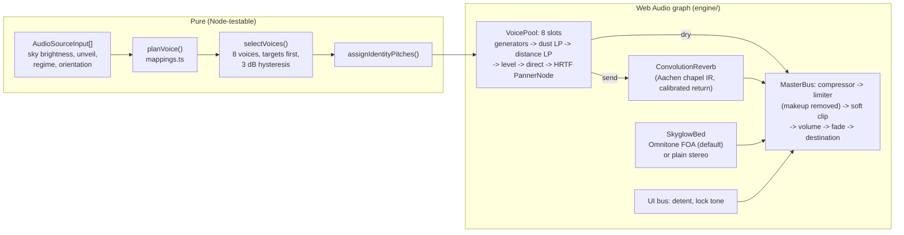

# Albedian Spatial Audio Engine

Status: **Locally implemented and tested capability** (November 2026). Pure mappings are covered by
property tests; the Web Audio graph was exercised in Chrome 152 on macOS. Nothing here has been
judged by a human ear yet; section 10 lists what needs one.

Code: [`apps/web/src/audio/`](../../apps/web/src/audio/). Listening harness:
[`apps/web/spike/audio/`](../../apps/web/spike/audio/) (run `pnpm dev`, open `/spike/audio/`).

## 1. Rules the engine follows

1. **One perceptual channel per physical quantity.** Each quantity drives exactly one audible
   attribute, listed in section 4. Pitch carries no quantity (section 4.8).
2. **A missing input silences what it drives.** Every mapping returns `null` for a missing or
   invalid input and the engine renders `null` as silence. A star without `teffK` is not played
   with a "neutral" timbre; a voice without `residualArcsec` gets no uncertainty layer at all
   (not a clean interval, which would claim a lock); without `extinctionAvMag` there is no
   muffling filter. `getSnapshot().silent` names the missing inputs.
3. **No narration and no theater.** The procedural per-regime drones (the "MHD convection hum",
   the "relativistic sub-bass") were removed because they encoded no data. With no data, enabling
   audio plays only the UI detent.
4. **No AudioContext before a user gesture.** Importing the module and every setter are
   context-free; only `toggle()`/`enable()` (or `SpatialAudioEngine.start()`) create or resume
   one, and those are called from click handlers. A test stubs `window.AudioContext` to check it.

## 2. Architecture



| File | Role |
|---|---|
| `mappings.ts` | Every data-to-parameter mapping (pure). |
| `voicePlanning.ts` | Input types, `planVoice`, `selectVoices`, identity pitches, listener geometry (pure). |
| `dsp.ts` | Seeded noise, diffuse-field encodings, soft-clip curve, Schroeder phases, PeriodicWave coefficients, pulse-train series, IR energy normalization (pure). |
| `engine/SpatialAudioEngine.ts` | Composition root and lifecycle; `getSnapshot()` reports what sounds and why. |
| `engine/VoicePool.ts` | Bounded pool of HRTF voices realizing plans. |
| `engine/SkyglowBed.ts` | Bed renderers and the Omnitone loader with fallback. |
| `engine/ConvolutionReverb.ts` | Shared convolution reverb and its calibration. |
| `engine/MasterBus.ts` | Dynamics, clipping, volume, per-ear meter. |
| `ObservatoryAudioEngine.ts` | Public facade keeping the original API; `observatoryAudio` singleton. |
| `omnitone.d.ts` | Types for the parts of Omnitone the bed uses (the package ships none). |

**Lifecycle.** `start()` builds the graph, then loads two things asynchronously: the impulse
response (800 KB WAV, fetched on first enable) and Omnitone (dynamic `import()`, 52 KB minified
ESM). Neither is fetched for users who never enable audio. `stop()` fades the master out and
suspends the context 1.2 s later, so a disabled engine costs no CPU; the next `start()` resumes it.
Data set before `start()` is kept and plays at once when audio is enabled.

## 3. Spatial bed: library evaluation and choice

| | Omnitone 2.0.0 | Resonance Audio Web SDK 1.0.0 | Plain Web Audio |
|---|---|---|---|
| Maintenance (checked November 2026) | Active: 2.0.0 published September 2026, repository pushed October 2026 (CSP, bundler, promise-rejection and rotation fixes). | Repository archived (last push March 2022); last npm publish November 2017. Core `resonance-audio` repo also archived. | Browser API. |
| License | Apache-2.0; bundled Google/SADIE HRIRs Apache-2.0, (c) 2017 University of York. | Apache-2.0. | n/a |
| Offers | First- and higher-order ambisonic decoding to binaural through measured HRIRs; sound-field rotation; no runtime dependencies. | Shoebox room model (early reflections and late reverb from room size and materials), ambisonic panning, an old Omnitone 1.x inside. | `PannerNode` (HRTF) per point source; no representation of a whole field. |
| Types | None shipped (local shim). | None. | Built in. |

**Choice: Omnitone FOA for the bed; plain Web Audio HRTF panners for the point voices.**

1. The bed is a field around the listener, not a point. Ambisonics represents a whole field in a
   fixed four channels however many directions contribute, and rotates it with one 3x3 matrix.
   Plain Web Audio would need one HRTF `PannerNode` per direction.
2. An isotropic diffuse field encodes exactly as four uncorrelated noise signals with SN3D weights
   (1, 1/sqrt(3), 1/sqrt(3), 1/sqrt(3)) and decodes through measured HRIRs, so the interaural
   coherence comes from the decoder instead of a hand-set crossover (Engineering inference: FOA
   still over-estimates coherence at high frequencies compared with a real diffuse field).
3. Directional skyglow, such as a light dome on one horizon taken from the photo's background
   map, would cost four gains and the rotation matrix, not more panners (**Proposed design**, not
   built: today the only input is a single sky-brightness value, so the bed is isotropic).
4. It is maintained, permissively licensed, dependency-free, and lazy-loaded after the gesture.

Resonance Audio is rejected: archived, and its shoebox room model has no physical meaning in space
while duplicating what the convolution reverb already does.

**Fallback and A/B.** A plain Web Audio bed (`stereo-diffuse`: shared content below 700 Hz,
independent above) is used when Omnitone fails to load or initialize, and the reason appears in
`getSnapshot().bed.fallbackReason`. It is also selectable in the harness to compare by ear. The two
renderers are matched in per-ear power (Omnitone +2.8 dB, measured; section 6).

**Omnitone behaviours to know.** It logs `[Omnitone] ...` lines to the console on import and on
each initialization. When it detects Safari and both `webkitAudioContext` and
`webkitOfflineAudioContext` exist, it overwrites `window.AudioContext` with the prefixed one; the
bed declines Omnitone when the prefixed constructor is a different class, so that global is never
changed under the rest of the app.

## 4. Mappings

Defaults live in `mappings.ts` as named constants. "Basis" separates **Verified external
capability** (a cited fact), **Engineering inference** and **Proposed design** (a choice that needs
listening).

### 4.1 Distance: direct-to-reverberant ratio and high-frequency rolloff

- Input `distancePc`. `p` is its position, in log distance, inside the window of the current
  regime (`REGIME_DISTANCE_WINDOWS`, e.g. 1 to 2000 pc for `earth_capture`, 1,000 to 10 million km
  for `cislunar`). The window is a display choice like a map's scale bar, set by `setScaleRegime`.
- DRR = lerp(+15 dB, -15 dB, p). The dry and reverb sends split unit energy:
  direct = sqrt(r/(1+r)), reverb = sqrt(1/(1+r)), r = 10^(DRR/10), so distance moves energy
  between direct and reverberant without changing the voice's loudness.
- Low-pass cutoff = 18 kHz x (3 kHz / 18 kHz)^p, Q 0.5.
- Basis: level and DRR are the main absolute distance cues, with spectral loss adding at long
  range, and perceived distance is a compressive function of physical distance (Verified external:
  Zahorik, Brungart and Bronkhorst 2005, Acta Acustica united with Acustica 91(3), 409-420). The
  +/-15 dB range, the 3 kHz far cutoff and the windows are Proposed design.
- Delivered DRR matches the plan within 0.8 dB in Chrome (section 6).

### 4.2 Luminosity: loudness at the source, attenuated with distance

- Inputs `luminositySolar`, `distancePc`. m_bol = 4.74 - 2.5 log10(L) + 5 log10(d / 10 pc)
  (apparent bolometric magnitude, no extinction term).
- Level = -10 dBFS - 4 x kappa x (m_bol + 1.5), kappa = 1, capped at -6 dBFS. Below -60 dBFS the
  voice is silent as too faint, which `getSnapshot()` reports separately from missing data.
- Basis (Verified external): Pogson's scale makes one magnitude exactly 4 dB of intensity; IAU 2015
  Resolution B2 fixes M_bol(Sun) = 4.74; source power proportional to L with inverse-square
  attenuation is the same thing as 4 dB per magnitude of apparent brightness, so the loudest voice
  is the brightest-looking object. Engineering inference: in Stevens' tables loudness grows with
  sound pressure to the 0.67 power (about 0.33 of intensity) and brightness of a 5 degree target in
  the dark with luminance to the 0.33 power, so intensity-for-flux keeps the two percepts growing at
  similar rates (Poulton's caveat applies: these exponents depend on procedure).

### 4.3 Effective temperature: timbre brightness

- Input `teffK`, clamped to 2,000 to 40,000 K. The voice is a harmonic tone at its identity pitch
  whose harmonic powers sample the Planck curve scaled into hearing:
  P_n proportional to x^3 / (e^x - 1), x = n f0 / f_T, f_T = (1000 Hz / 3.8322) x (T / 5772 K),
  normalized to unit power, with Schroeder (1970) phases to keep the crest factor low.
- 3.8322 = 4 zeta(5) / zeta(4) is the power-weighted mean of B_nu in units of kT/h, so the
  spectral centroid is proportional to Teff (Wien displacement): the Sun's voice sits at 1 kHz.
  Measured in the browser: 3000 K 521 Hz, 5772 K 1002 Hz, 13000 K 2252 Hz, 25000 K 4326 Hz.
- Basis: the Planck curve is Verified external physics; the scale factor (Sun at 1 kHz) is
  Proposed design. That the centroid rises strictly with Teff for discrete harmonics follows from
  the curve's monotone likelihood ratio and is property-tested.

### 4.4 Skyglow: broadband noise bed

- Inputs `skyBrightnessMagArcsec2` (V mag/arcsec^2) and the user's `unveil` control (0 to 1).
- ratio = max(0, 10^(-0.4 (SB - 22.0)) - 1): the ratio of artificial to natural sky brightness.
  Level = -34 dBFS + 10 log10(ratio x (1 - unveil)), capped at -12 dBFS, silent below -72 dBFS.
  A natural sky (SB 22.0 or darker) is silent: the hiss is the light pollution only.
  The bed is heard only in the `earth_capture` regime (skyglow exists inside the atmosphere).
- Spectrum: pink noise, 180 Hz high-pass.
- Basis (Verified external): Falchi et al. 2016, Science Advances 2(6) e1600377, use a natural
  background of 174 ucd/m^2, about 22.0 mag/arcsec^2 in V, and map exactly this artificial-to-
  natural ratio. Intensity proportional to artificial flux is the Pogson choice again. Design
  intent (Proposed design): as the user unveils the sky, the hiss fades and faint voices emerge
  from it, an analogue of skyglow hiding faint stars. The masking threshold is not calibrated to
  the visual limiting magnitude.

### 4.5 Uncertainty: beating that resolves at lock

- Input `residualArcsec` (for example `ScientificEvidence.angularResidualArcsec`).
- Beat = 4 Hz x min(1, residual / 120 arcsec), proportional below full scale.
- Two quiet three-harmonic tones form a just fifth on twice the voice pitch. The upper tone is
  raised by beat / 2, so the lower tone's third harmonic and the upper tone's second harmonic beat
  at exactly `beat` Hz; at zero residual the fifth is clean (3:2). Without a residual the layer is
  absent.
- Basis: Proposed design (rates and full scale need listening).

### 4.6 Pulsars: real spin rates, no scaling

- Input `spinFrequencyHz` (ATNF `F0`). The pulse rate is that number, set on an oscillator's
  frequency parameter with no glide. Verified external values used in tests and harness presets
  (ATNF Pulsar Catalogue v2.6.1): Crab, J0534+2200, F0 = 29.9469230 Hz (PEPOCH MJD 48442.5);
  Vela, J0835-4510, F0 = 11.1946499395 Hz (PEPOCH MJD 51559.319).
- Sound: broadband noise gated by a Gaussian pulse train, FWHM 3 % of the period. The pulse shape
  is generic; only the rate comes from data. For pulsars the `luminositySolar` input is whatever
  power the caller supplies (the harness uses ATNF `EDOT` / 3.828e33 erg/s).

### 4.7 Dust column: muffling

- Input `extinctionAvMag`. Low-pass cutoff = 20 kHz x 2^(-A_V / 1 mag), floor 120 Hz, Butterworth.
  Without A_V the filter sits at Nyquist (an identity), so there is no muffling layer.
- Basis: dust removes short wavelengths first (reddening), and the audio analogue removes highs;
  the one-octave-per-magnitude rate is Proposed design.

### 4.8 What is not data

- **Identity pitch.** Voices take pitches from a just pentatonic set on 110 Hz (110 to 440 Hz),
  chosen by an FNV-1a hash of the object id, kept while the object stays in the pool and never
  shared by two active voices. Pitch keeps simultaneous voices separable and lets a listener follow
  one object; it encodes nothing.
- **UI cues.** `playDetentClick` is unchanged interface feedback. `playTargetLockTone(bv, panX)`
  is a clean just fifth (220 and 330 Hz) with the Planck timbre of Ballesteros (2012, EPL 97,
  34008, Eq. 14) applied to B-V, stereo-panned by `panX`. It is silent if either value is missing,
  and B-V outside -0.5 to 3.0 counts as missing because the paper gives no validity range and the
  formula has a pole near -0.67.

## 5. Master bus

Compressor at -10 dBFS, 4:1, hard knee, 5 ms attack, 200 ms release; limiter at -2 dBFS, 20:1,
1 ms attack, 100 ms release; soft clipper (identity to 0.75, tanh to a 0.966 ceiling, 4x
oversampling); volume (default 0.85, as before); enable fade; per-ear meter.

Web Audio's `DynamicsCompressorNode` applies automatic makeup gain, (1 / curve(0 dBFS))^0.6. With
the first settings tried (-20 dB 2.5:1 soft knee, -3 dB 20:1) Chrome added +7.2 dB to quiet signals
and compressed the 4 dB-per-magnitude scale above about -30 dBFS. Both stages now use a hard knee,
whose makeup gain has a closed form (`compressorMakeupGainDb`), and a gain node after each stage
divides it back out, so the bus is unity-gain below threshold.

## 6. Calibration measurements

Chrome 152 on macOS, 48 kHz. OfflineAudioContext renders used the same node settings as the engine;
live readings came from the master bus meter (mean per-ear power).

| Measurement | Result |
|---|---|
| HRTF `PannerNode` per-ear gain, pink noise, front / azimuth -40 elevation 10 | -2.1 dB / -1.9 dB |
| Same for the Sun-like voice tone (5772 K at 330 Hz) | -1.8 dB / -1.0 dB |
| Unit-energy IR per-ear gain: pink noise, 3000 K, 5772 K, 25000 K tones | +4.6, +5.6, +5.0, +3.9 dB |
| Resulting reverb return calibration (pink noise, frontal) | -6.7 dB (`REVERB_RETURN_CALIBRATION_DB`) |
| Delivered vs planned DRR, live, Sun-like voice at 1.5 / 10 / 300 pc | 14.0 vs 13.4, 6.6 vs 5.9, -6.7 vs -7.5 dB |
| Voice level across those distances with L scaled by d^2 | constant within 0.8 dB |
| Makeup gain of the first compressor settings (Chrome) | +5.5 dB and +1.8 dB (formula gives +1.71 dB for the second) |
| Bed per-ear power at the same requested -20.2 dB: Omnitone FOA vs stereo | -40.5 vs -37.7 dBFS (trim +2.8 dB) |
| Output with every source silent | -104 dBFS |

The DRR calibration was taken on pink noise; for cool stars (most energy below 1 kHz) the wet path
runs about 1.8 dB hotter than for the Sun-like tone. A per-voice correction is possible later.

## 7. Assets and licenses

**Impulse response** `apps/web/src/audio/assets/aachen-nikolauskapelle-s1-r12-stereo.wav`
(48 kHz stereo, 4.17 s, 800,660 bytes). Derived from Martin Zerwas and Selin Kayku, "Room acoustic
measurement and decay analysis data of the St. Nicholas Chapel, Aachen Cathedral", version 1.2,
Zenodo, https://doi.org/10.5281/zenodo.23312556, licensed **CC BY 4.0**. Measured response
`S1-Do_R12.wav` (FuMa B-format; source and receiver in the main hall, 9.24 m apart; broadband T30
about 4.0 s from our analysis, mid-frequency T about 4.6 s per the dataset). Changes: direct sound
removed (trim 3 ms after onset), decoded to two coincident virtual cardioids at +/-90 degrees,
40 Hz high-pass, fades into the noise floor at 4.2 s, gain to -1 dBFS, 16-bit with triangular
dither. Full record, checksums and the exact operations:
[`ATTRIBUTION.txt`](../../apps/web/src/audio/assets/ATTRIBUTION.txt). The late-tail interchannel
correlation is 0.52 to 0.55, as expected (0.5) for that cardioid pair in a diffuse field.

Why not OpenAIR: in November 2026 both `openair.hosted.york.ac.uk` and `openairlib.net` served an
expired TLS certificate, and a binary asset was not downloaded over an unverified connection.
The Zenodo record was fetched over verified HTTPS; only the one member was transferred, using HTTP
range requests, and its CRC-32 was checked against the zip directory. The chapel is an earthly room:
its tail is a device for the distance cue, not a claim about the acoustics of space.

Reproduce the conversion (ffmpeg 8.1, from the extracted member):

```sh
ffmpeg -i S1-Do_R12.wav -af "atrim=start=0.03012:end=4.2,asetpts=PTS-STARTPTS,\
pan=stereo|c0=0.70710678*c0+0.5*c2|c1=0.70710678*c0-0.5*c2,highpass=f=40:p=2,\
afade=t=in:st=0:d=0.003:curve=hsin,afade=t=out:st=3.37:d=0.8:curve=hsin" -c:a pcm_f32le stereo.wav
ffmpeg -i stereo.wav -af "volume=3.699dB,aresample=dither_method=triangular" -c:a pcm_s16le \
  -map_metadata -1 -fflags +bitexact -flags:a +bitexact aachen-nikolauskapelle-s1-r12-stereo.wav
```

**Omnitone 2.0.0** (npm `omnitone`, Apache-2.0, copyright Google). Its bundled HRIRs are derived
from the Google/SADIE binaural filters, copyright 2017 University of York, also Apache-2.0; the
notice is `src/resources/NOTICE` in the Omnitone repository. Shipping the built app redistributes
both, so release notices must carry the Apache-2.0 attribution and that NOTICE text.

## 8. Integration with the viewport and renderer

The viewport currently calls only `toggle`, `setScaleRegime` and `playDetentClick`, so in the app
**enabling audio plays only the detent until data is wired**. The header volume slider is not yet
connected to `setMasterVolume`. Wiring belongs to the viewport and renderer owners:

```ts
observatoryAudio.setListenerOrientation(cameraQuaternionXYZW); // per frame, same world frame as directions
observatoryAudio.setSources(objects.map((o) => ({
  id: o.id,
  kind: 'star',
  directionWorld: o.unitVectorFromCamera,
  distancePc: o.distancePc,
  luminositySolar: o.luminositySolar,
  teffK: o.teffK,
  extinctionAvMag: o.avMag,       // optional
  residualArcsec: o.residualArcsec, // optional
  isTarget: o.id === selectedId,
  evidenceClass: o.evidenceClass,
})));
observatoryAudio.setSkyBrightness(skyMagArcsec2OrNull);
observatoryAudio.setUnveil(revealFraction);
```

| Engine input | Source available today | Note |
|---|---|---|
| `distancePc` | `CelestialFinding.inferredDistancePc.median`, `CatalogReference.bailerJonesDistancePc.median` | Never `1000 / parallax` for parallax <= 0 (scientific-integrity steering). |
| `directionWorld` | `raDecToUnitVector` from `@albedian/camera-rig`, in the camera's frame | Must share a frame with the listener quaternion. |
| `residualArcsec` | `ScientificEvidence.angularResidualArcsec` | |
| `teffK`, `luminositySolar` | `services/science/deep_sky.py` `compute_stellar_astrophysics` output | Not in `packages/contracts` yet. |
| `skyBrightnessMagArcsec2` | `/api/science/radiometry` `krisciunasSchaeferSky.skyBrightnessMagArcsec2` | A model (predicted) value; the UI should say so. |
| `extinctionAvMag`, `spinFrequencyHz` | No source yet | Would need a dust map and an ATNF subset. |

Adding these fields to the contracts is an architecture decision and is escalated, not done here.
Audio cannot display an evidence class, so whatever inspector shows the target should disclose the
class of the values being heard; `getSnapshot()` passes `evidenceClass` through for that.

## 9. Verification

- `pnpm typecheck` and `pnpm test` from the repository root; the audio suites are
  `apps/web/src/audio/__tests__/` (mappings, voice planning, DSP, engine lifecycle). Property tests
  (fast-check) cover monotonicity, bounds and silence-on-missing for every mapping, energy
  preservation of the DRR split, exact pass-through of spin rates, pool bounds and hysteresis,
  pitch uniqueness, quaternion invariants, the clip curve and IR normalization.
- The harness typechecks with `pnpm --dir apps/web exec tsc -p spike/audio/tsconfig.json`.
- In Chrome 152: no context before the click; IR and Omnitone load after it; 16 sources reduce to
  8 voices with the target first; dust, beating, pulsar rate and centroids match their formulas; the
  app's Audio button still toggles; no console errors. Safari, Firefox and mobile are **not tested**.

## 10. What needs a human ear

1. Balance between bed, voices and UI detents; every absolute level is an engineering default.
2. Distance: whether +/-15 dB of DRR and the per-regime windows read as "near" and "far" rather
   than "dry" and "wet"; whether the 3 kHz far cutoff fights the Teff timbre.
3. Teff timbre: whether 4.3 octaves of centroid travel is pleasant; hot stars put energy in many
   unresolved harmonics and may sound buzzy, cool stars are close to a sine.
4. Separability of the three spectral channels (Teff, distance rolloff, dust): a hot, distant,
   dusty star and a cool, near one may sound alike. Untested.
5. Loudness at 4 dB per magnitude: whether the range is right in practice. Perceived loudness also
   depends on spectrum (bright timbres sound louder at equal power) and is not compensated.
6. Skyglow: hiss colour, the -34 dB reference, and whether faint voices drop out under the hiss at
   roughly the sky brightness where the eye loses them.
7. Bed renderers: Omnitone FOA against the plain stereo bed, on headphones and on speakers. They
   are matched in power, not in loudness.
8. Uncertainty: the 4 Hz ceiling, the 120 arcsec full scale, the level of the fifth against the
   star tone, and whether "no layer" and "clean fifth" are distinguishable.
9. Pulsars: the generic 3 % pulse and noise carrier; envelopes are peak-normalized, so a pulsar
   sounds quieter than a steady star at the same mapped level; very slow pulsars become soft swells.
10. Identity pitch: whether listeners read pitch as data although it carries none.
11. Reverb: the chapel's warm 4 s tail as the "space" around voices; the cardioid-pair width.
12. HRTF: Chrome's generic built-in set (front/back confusion, no personalization); the voices
    (browser HRTF) and the bed (SADIE) use different HRIR sets.
13. Transitions: attack and release constants, and pitch glides when a voice is reassigned.

## 11. Limitations and open questions

- **Unresolved technical question:** the Safari path (Omnitone's global patch guard, the
  `StereoPannerNode` lock tone) and Firefox behaviour are untested.
- Absolute output levels include the HRTF panner's roughly -2 dB per ear.
- Beds use 10 s noise loops (about 7.7 MB at 48 kHz for the four-channel bed) generated on the main
  thread at first enable.
- Omnitone's console logging cannot be turned off.
