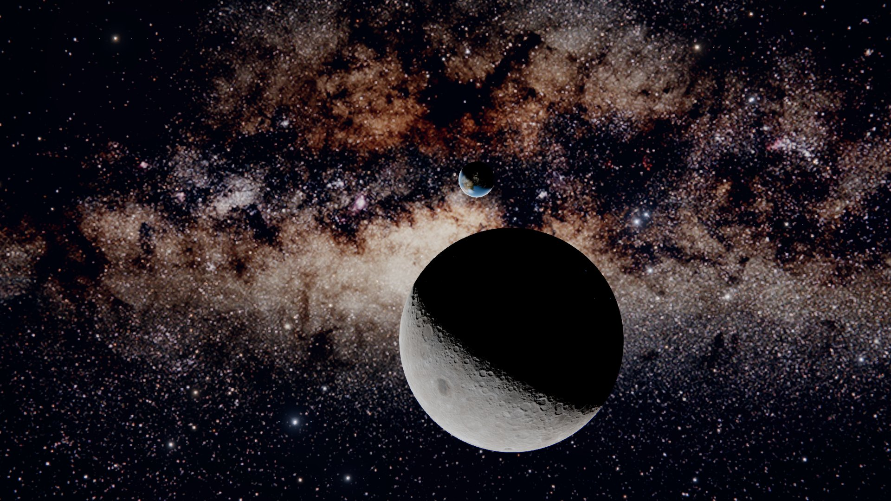

# The landing moment: the Earth in front of the galactic centre, seen from beyond the Moon

Scene 01 on the WebGPU host shows one real moment, 2025-03-07 11:00 UTC, at true scale: the Earth and
the Moon where JPL Horizons puts them, turned as they were, lit by that moment's Sun, and seen from a
simulated camera beyond the Moon's far side with the centre of the Milky Way behind the Earth. The
WebGL renderer uses a composed cislunar view, disclosed as such in its render layer set.

## The moment and its sources

- **Positions** [verified]: `scripts/plan_landing_moment.py` asks the JPL Horizons API (version 1.2,
  ephemeris DE441) for the geocentric Moon and Sun (ICRF, geometric) and, as check values, the
  sub-observer and sub-solar points of the Moon seen from the Earth's centre and of the Earth seen
  from the Moon's centre. Four requests, one at a time, cached under `.cache/horizons/`, with the
  User-Agent `Albedian/0.1 (research prototype)`. The values, the query URLs and the retrieval times
  are in `apps/web/src/spatial/webgpu/cislunar/landingMoment.json`; `--verify` rebuilds that file
  from the cache byte for byte.
- **Why this hour** [verified]: seen from the Earth's centre the Moon is 0.385 deg from the galactic
  anti-centre (l 180, b 0, through the Hipparcos ICRS-to-galactic matrix the sky registration uses;
  Horizons' own galactic coordinates of the Moon are l 180.080, b -0.377), so from beyond the Moon the
  Earth stands within half a degree of the galactic centre. The closest hour in the window of
  +-24 h is 12:00 UTC at 0.378 deg; 11:00 is the lead's decision.
- **Lighting** [verified]: the phase angle of the Moon seen from the Earth is 80.1 deg and of the
  Earth seen from the Moon 99.7 deg, so from the camera both are about 41% lit [inference], with long
  terminators. The Earth's sub-Moon point is 116.07 E 28.85 N (geodetic) and its sub-solar point
  17.74 E 5.12 S: East Asia is on the night side, just past the evening terminator.
- **Orientation** [tested]: `apps/web/src/spatial/bodyOrientation.ts` turns the Moon by the IAU
  WGCCRE model (Archinal et al. 2018, which keeps the 2009 lunar model) with the libration terms E1
  to E13, and the Earth by Greenwich mean sidereal time (IAU 1982) after the IAU 1976 precession,
  with UT1 taken as UTC. Against Horizons the sub-observer and sub-solar points agree within
  0.0063 deg and the Moon's pole within 0.002 deg; light time (1.3 s, up to 0.006 deg of the Earth's
  turn), aberration and nutation are left out.

## The composition

- **Scale**: one scene unit is 1000 km; the Earth (radius 6371 km) at the origin, the Moon (1737.4 km)
  at its Horizons position.
- **Viewpoint**: the camera stands on the line from the galactic centre through the Earth, so the
  Earth is exactly in front of the galactic centre (l 0, b 0). Its distance, 395,273 km from the
  Earth and 15,472 km above the Moon's far side, is the one composition choice: it puts the Moon's
  centre 8.5 deg from the Earth's, with the Moon 11.6 deg across and the Earth 1.85 deg. Galactic
  north is up, so the Milky Way runs level through the Earth; the view looks between the two bodies
  with a vertical field of view of 26 deg. All of this is in
  `apps/web/src/spatial/webgpu/cislunar/landingScene.ts`.
- **Light and exposure**: one Sun, its direction from each body taken from the same Horizons vector.
  The Moon's SVS colour map, made for appearance, has an area-weighted mean linear luminance of
  0.483; it is scaled to the Moon's geometric albedo of 0.12 (NASA Moon fact sheet) so the Moon has
  its true brightness beside the Earth. The camera exposes for the sunlit bodies (exposure 3), and
  the sky panorama and the catalog stars are drawn at 0.3 of their usual grade: the Milky Way is
  shown far brighter than one exposure could record it, and dimmer than the bodies. City lights are
  drawn at their former display level, far brighter than an exposure for the day side shows them.
  The night sides are unlit: the Moon's far side never faces the Earth, so no earthshine reaches it,
  and moonlight on the Earth's night side is a few millionths of sunlight at most.
- **Removed for this view**: the Earth material's hand-set tilt that turned the Mediterranean to the
  camera (it samples in the globe's own frame), its warm twilight terms, which made the
  terminator brighter than the day side, its blue fill of the night side and the atmosphere shell's
  glow around the night side; the bodies' spin; and the observer-hemisphere flip.

## Angular resolution and screen sampling

At the landing camera's 26 deg vertical field of view, screen angular density is 41.5 screen px / deg at 1920x1080 and 83.1 screen px / deg at 3840x2160.

| Layer | Asset & dimensions | Angular resolution | Screen sampling at 1080p | Screen sampling at 4K |
|---|---|---|---|---|
| Sky diffuse panorama | `eso_milkyway_diffuse_6k.webp`, 6000x3000 | 16.7 texels / deg (216 arcsec / texel) | 0.40 texels / px (2.49x magnified) [measured] | 0.20 texels / px (4.99x magnified) [computed] |
| Catalog stars | Gaia DR3 and Hipparcos tiles to G 12 (256 tiles) | Sub-arcsecond ICRS directions | Analytic-PSF sprites evaluated per screen pixel [tested] | Analytic-PSF sprites evaluated per screen pixel [tested] |
| Moon colour | `moon_lroc_color_poles_8k.jpg`, 8192x4096 | 22.8 texels / deg | 8.5 texels / px at disk centre (11.6 deg disk = 482 px, minified) [computed] | 4.3 texels / px at disk centre (964 px disk, minified) [computed] |
| Moon LOLA normals | `moon_lola_normal_5k.png`, 5760x2880 | 16.0 texels / deg | 6.0 texels / px at disk centre (minified) [computed] | 3.0 texels / px at disk centre (minified) [computed] |
| Earth day and night | 8192x4096 maps (clouds 2048x1024, height 4096x2048) | 22.8 texels / deg (5.7 clouds, 11.4 height) | 53.2 texels / px at disk centre (1.85 deg disk = 77 px, minified) [computed] | 26.6 texels / px at disk centre (154 px disk, minified) [computed] |

## Checks

| Check | Command | Result |
|---|---|---|
| Rotation models against Horizons | `pnpm exec vitest run apps/web/src/spatial/__tests__/bodyOrientation.test.ts` | within 0.01 deg [tested] |
| Landing geometry (camera line, separation, galactic north up, mesh orientations against Horizons) | `pnpm exec vitest run apps/web/src/spatial/webgpu/__tests__/landingScene.test.ts` | within 1e-9 rad and 0.01 deg [tested] |
| Earth and Moon map sampling against the sphere layout | `pnpm exec vitest run apps/web/src/spatial/webgpu/__tests__/earthSampling.test.ts apps/web/src/spatial/webgpu/__tests__/moonSphereFrame.test.ts` | pass [tested] |
| Far-side features on screen | `uv run python scripts/check_landing_moon_features.py <capture dir>` | Mare Moscoviense -15.4 and Mare Ingenii -4.0 levels darker than their surroundings where the mesh puts them; maps mirrored, shifted by 180 deg or flipped north to south each miss [tested] |
| Sky dome against the catalog stars in this view | `uv run python scripts/check_sky_dome_on_screen.py <capture dir> webgpu` | 12 named stars, median 0.434 texels (2.48 px per texel), max 1.348 [tested] |

Captures come from `node scripts/capture_landing.mjs --out <dir> --url <dev server> --renderer webgpu
--scene 0 --t 4 --size 1920x1080` (or 3840x2160). The tool now keeps each frame in the page,
compares frames by SHA-256 there and brings the chosen one over in 1 MB pieces: DevTools replies of
3 MB arrive, but replies of 4.7 MB and more never did, and a 1080p frame of this busy sky is a 4.7 MB
data URL [tested].

## Open

- **Cast shadows** [open]: the Moon's relief is in its normals only; crater rims cast no shadows along
  the terminator. Horizon maps baked from the LOLA heights would add them.
- **The Earth's surface and clouds** [open]: the day map is NASA's Blue Marble for November 2004 (its
  March month would match the season's snow cover), and the cloud layer is not that day's weather
  and has no recorded provenance (data-5a brings NASA's cloud layer). With most clouds missing, the
  Earth is darker than its albedo of about 0.3.
- **Sky resolution** [open]: removing resolved point stars from `eso_milkyway_diffuse_6k.webp` and drawing catalog stars to G 12 eliminates magnified star blocks, while the diffuse Milky Way background itself spans 2.49 px per texel at 1080p [tested] and 4.99 px per texel at 2160p [computed].
- **The anamorphic streak**: replacing copies of bright pixels at fixed offsets with one
  continuous horizontal Gaussian carrying the same energy adds less than one
  code value per pixel along a star's streak at 1080p, so the landing shows no streak [tested]; a
  visible line would need about ten times the energy [inference], a look choice.
